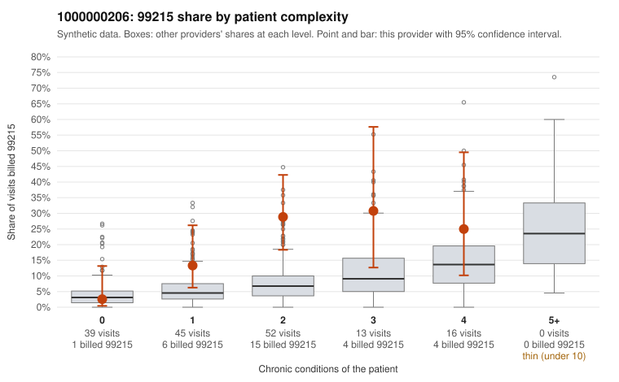

# 1000000206: 1000000206: too few returned records to judge

**Leaning (advisory):** Inconclusive

## Why

1000000206 billed 99215 on 18.2% of 165 claims against an expected 5.6% given patient complexity (risk-adjusted score 2.81; plain z-score vs peers 1.66). 23% of this provider's 99215 claims were on patients with 0 or 1 chronic conditions. Records came back for 19 claims. Of 5 documented 99215 claims, 1 (20%) were documented below the billed level, against 22% for the comparison providers. Note checks on 19 returned notes (share showing each sign): problems 10%, late 5%, unsigned 0%, data 5%. No audit trail was received. 1 of 13 notes claiming moderate-or-higher data reviewed had no lab or test line on the claim. The evidence does not support a call either way yet. Examples: C0094762: billed 99215, patient aged 51 with 1 chronic condition(s) (hyperlipidemia); documented MDM level moderate, 35 minutes. C0094721: billed 99215, patient aged 45 with 1 chronic condition(s) (hyperlipidemia); documented MDM level high, 54 minutes. C0094722: billed 99215, patient aged 46 with 1 chronic condition(s) (hyperlipidemia).

## Evidence chart

## Cited claims

`C0094762`, `C0094721`, `C0094722`

## Suggested next steps

- 19 charts came back but do not settle it: request a targeted sample of 99215 charts, starting with C0094762, C0094721, C0094722.
- Re-check after the targeted charts arrive; do not call upcoding or a sicker panel on this evidence alone.

---
Citations checked: 3/3 valid. Synthetic data. The leaning is advisory; the flag comes from the statistical screen, and no clinical documentation is available beyond the sampled records-review facts shown in the packet.
