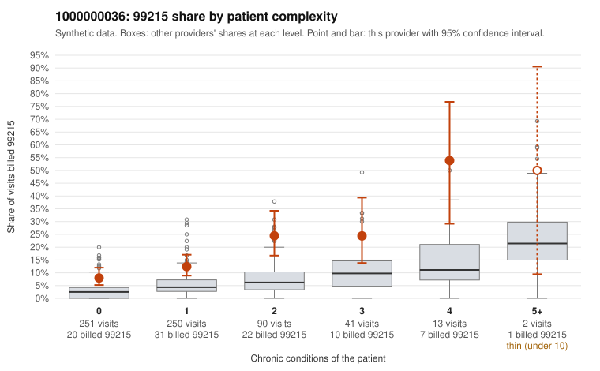

# 1000000036: 1000000036: too few returned records to judge

**Leaning (advisory):** Inconclusive

## Why

1000000036 billed 99215 on 14.1% of 647 claims against an expected 4.1% given patient complexity (risk-adjusted score 4.59; plain z-score vs peers 1.33). 56% of this provider's 99215 claims were on patients with 0 or 1 chronic conditions. Records came back for 42 claims. Of 18 documented 99215 claims, 2 (11%) were documented below the billed level, against 48% for the comparison providers. Note checks on 42 returned notes (share showing each sign): problems 38%, late 2%, unsigned 0%, data 10%, bulk created 0%, paste heavy 0%. 4 of 29 notes claiming moderate-or-higher data reviewed had no lab or test line on the claim. The evidence does not support a call either way yet. Examples: C0013220: billed 99215, patient aged 61 with 1 chronic condition(s) (depression); documented MDM level moderate, minutes not recorded. C0013273: billed 99215, patient aged 41 with 1 chronic condition(s) (type 2 diabetes); documented MDM level moderate, minutes not recorded. C0012961: billed 99215, patient aged 51 with 0 chronic condition(s). C0012964: billed 99215, patient aged 38 with 0 chronic condition(s).

## Evidence chart

## Cited claims

`C0013220`, `C0013273`, `C0012961`, `C0012964`

## Suggested next steps

- 42 charts came back but do not settle it: request a targeted sample of 99215 charts, starting with C0013220, C0013273, C0012961.
- Re-check after the targeted charts arrive; do not call upcoding or a sicker panel on this evidence alone.

---
Citations checked: 4/4 valid. Synthetic data. The leaning is advisory; the flag comes from the statistical screen, and no clinical documentation is available beyond the sampled records-review facts shown in the packet.
