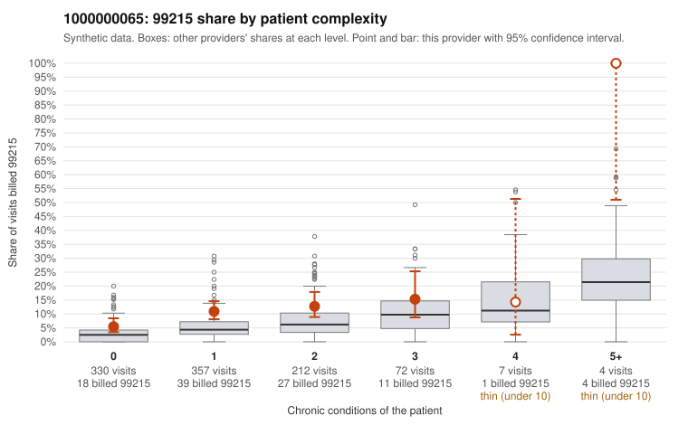

# 1000000065: 1000000065: documented 99215 claims mostly support the level billed (18% below)

**Leaning (advisory):** Pattern consistent with a high-acuity panel

## Why

1000000065 billed 99215 on 10.2% of 982 claims against an expected 4.3% given patient complexity (risk-adjusted score 3.26; plain z-score vs peers 0.60). 57% of this provider's 99215 claims were on patients with 0 or 1 chronic conditions. Records came back for 45 claims. Of 17 documented 99215 claims, 3 (18%) were documented below the billed level, against 48% for the comparison providers. Note checks on 45 returned notes (share showing each sign): problems 44%, late 7%, unsigned 0%, data 7%. No audit trail was received. 6 of 36 notes claiming moderate-or-higher data reviewed had no lab or test line on the claim. This pattern is consistent with a high-acuity panel. The sampled documentation supports the billed level. Examples: C0029504: billed 99215; documented MDM level high, 41 minutes. C0029848: billed 99215, patient aged 55 with 1 chronic condition(s) (hyperlipidemia); documented MDM level high, minutes not recorded. C0030183: billed 99215, patient aged 76 with 5 chronic condition(s) (type 2 diabetes;obesity;hypertension;COPD;osteoarthritis); documented MDM level high, 50 minutes. C0029919: billed 99215, patient aged 29 with 4 chronic condition(s) (type 2 diabetes;obesity;hypertension;osteoarthritis). C0030065: billed 99215, patient aged 75 with 5 chronic condition(s) (hypothyroidism;obesity;atrial fibrillation;asthma;osteoarthritis).

## Evidence chart

## Cited claims

`C0029504`, `C0029848`, `C0030183`, `C0029919`, `C0030065`

## Suggested next steps

- Do not pursue recovery on this evidence: 45 charts came back and they support the level billed (3 of 17 documented 99215 claims below the billed level).
- Revisit if the 99215 share keeps rising against peers or a larger sample shows unsupported claims.

---
Citations checked: 5/5 valid. Synthetic data. The leaning is advisory; the flag comes from the statistical screen, and no clinical documentation is available beyond the sampled records-review facts shown in the packet.
