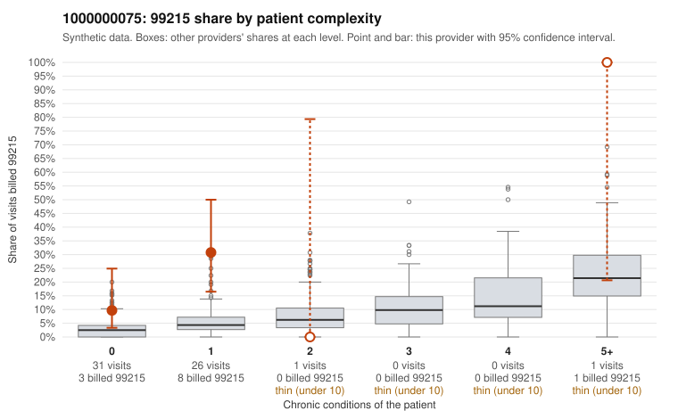

# 1000000075: 1000000075: too few returned records to judge

**Leaning (advisory):** Inconclusive

## Why

1000000075 billed 99215 on 20.3% of 59 claims against an expected 3.6% given patient complexity (risk-adjusted score 2.46; plain z-score vs peers 2.49). 92% of this provider's 99215 claims were on patients with 0 or 1 chronic conditions. Records came back for 30 claims. Of 7 documented 99215 claims, 0 (0%) were documented below the billed level, against 48% for the comparison providers. Note checks on 30 returned notes (share showing each sign): problems 47%, late 7%, unsigned 0%, data 13%, bulk created 0%, paste heavy 3%. 4 of 17 notes claiming moderate-or-higher data reviewed had no lab or test line on the claim. The evidence does not support a call either way yet. Examples: C0032337: billed 99214; documented MDM level low, minutes not recorded. C0032290: billed 99215, patient aged 19 with 1 chronic condition(s) (osteoarthritis); documented MDM level high, 54 minutes. C0032292: billed 99215, patient aged 72 with 1 chronic condition(s) (COPD).

## Evidence chart

## Cited claims

`C0032337`, `C0032290`, `C0032292`

## Suggested next steps

- 30 charts came back but do not settle it: request a targeted sample of 99215 charts, starting with C0032337, C0032290, C0032292.
- Re-check after the targeted charts arrive; do not call upcoding or a sicker panel on this evidence alone.

---
Citations checked: 3/3 valid. Synthetic data. The leaning is advisory; the flag comes from the statistical screen, and no clinical documentation is available beyond the sampled records-review facts shown in the packet.
