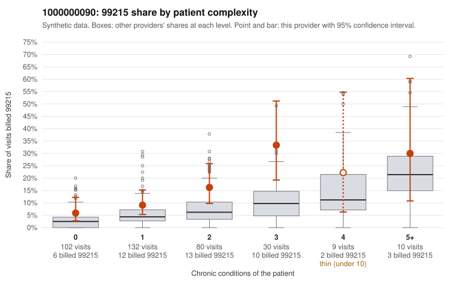

# 1000000090: 1000000090: too few returned records to judge

**Leaning (advisory):** Inconclusive

## Why

1000000090 billed 99215 on 12.7% of 363 claims against an expected 4.9% given patient complexity (risk-adjusted score 2.43; plain z-score vs peers 1.07). 39% of this provider's 99215 claims were on patients with 0 or 1 chronic conditions. Records came back for 45 claims. Of 17 documented 99215 claims, 8 (47%) were documented below the billed level, against 48% for the comparison providers. Note checks on 45 returned notes (share showing each sign): problems 24%, late 11%, unsigned 0%, data 9%. No audit trail was received. 5 of 33 notes claiming moderate-or-higher data reviewed had no lab or test line on the claim. The evidence does not support a call either way yet. Examples: C0038099: billed 99215, patient aged 33 with 1 chronic condition(s) (obesity); documented MDM level moderate, 35 minutes. C0038122: billed 99215; documented MDM level moderate, minutes not recorded. C0038096: billed 99215, patient aged 52 with 0 chronic condition(s); documented MDM level high, 30 minutes.

## Evidence chart

## Cited claims

`C0038099`, `C0038122`, `C0038096`

## Suggested next steps

- 45 charts came back but do not settle it: request a targeted sample of 99215 charts, starting with C0038099, C0038122, C0038096.
- Re-check after the targeted charts arrive; do not call upcoding or a sicker panel on this evidence alone.

---
Citations checked: 3/3 valid. Synthetic data. The leaning is advisory; the flag comes from the statistical screen, and no clinical documentation is available beyond the sampled records-review facts shown in the packet.
