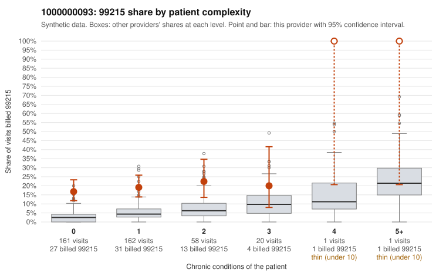

# 1000000093: 1000000093: 18 of 23 documented 99215 claims (78%) are documented below the billed level

**Leaning (advisory):** Pattern consistent with upcoding

## Why

1000000093 billed 99215 on 19.1% of 403 claims against an expected 3.9% given patient complexity (risk-adjusted score 5.71; plain z-score vs peers 2.26). 75% of this provider's 99215 claims were on patients with 0 or 1 chronic conditions. Records came back for 44 claims. Of 23 documented 99215 claims, 18 (78%) were documented below the billed level, against 48% for the comparison providers. Note checks on 44 returned notes (share showing each sign): problems 43%, late 4%, unsigned 0%, data 2%, bulk created 0%, paste heavy 0%. 4 of 34 notes claiming moderate-or-higher data reviewed had no lab or test line on the claim. This pattern is consistent with upcoding. It is a reason to review the records, not a finding. Examples: C0039033: billed 99215; documented MDM level moderate, 37 minutes. C0039079: billed 99215; documented MDM level moderate, minutes not recorded. C0039357: billed 99215; documented MDM level moderate, 37 minutes. C0038999: billed 99215, patient aged 42 with 0 chronic condition(s). C0039013: billed 99215, patient aged 42 with 1 chronic condition(s) (obesity); documented MDM level high, 33 minutes. C0039036: billed 99215, patient aged 31 with 1 chronic condition(s) (hypothyroidism).

## Evidence chart

## Cited claims

`C0039033`, `C0039079`, `C0039357`, `C0038999`, `C0039013`, `C0039036`

## Suggested next steps

- Request the full charts for C0039033, C0039079, C0039357 and have a certified coder re-score each against the current E/M rules (medical decision making or total time).
- If the re-scoring confirms the pattern, review the random sample in the recovery packet's sampling plan before any overpayment estimate; do not extrapolate from a targeted sample.
- Look at the notes themselves: 43% address fewer problems than their level implies and 4% were signed late; request the audit trail for C0039033, C0039079, C0039357.

---
Citations checked: 6/6 valid. Synthetic data. The leaning is advisory; the flag comes from the statistical screen, and no clinical documentation is available beyond the sampled records-review facts shown in the packet.
