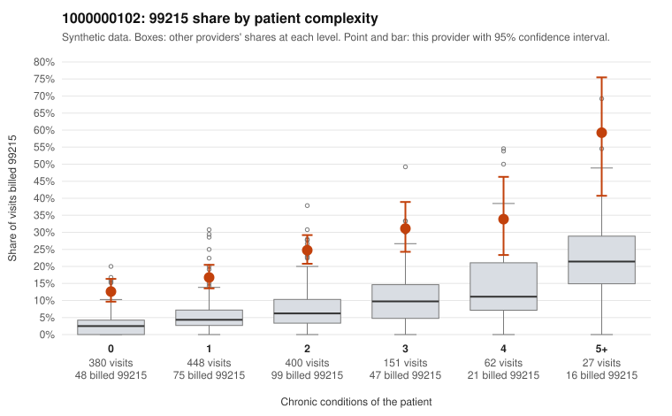

# 1000000102: 1000000102: too few returned records to judge

**Leaning (advisory):** Inconclusive

## Why

1000000102 billed 99215 on 20.8% of 1,468 claims against an expected 5.1% given patient complexity (risk-adjusted score 10.20; plain z-score vs peers 2.59). 40% of this provider's 99215 claims were on patients with 0 or 1 chronic conditions. Records came back for 30 claims. Of 8 documented 99215 claims, 1 (12%) were documented below the billed level, against 48% for the comparison providers. Note checks on 30 returned notes (share showing each sign): problems 30%, late 7%, unsigned 0%, data 7%. No audit trail was received. 3 of 21 notes claiming moderate-or-higher data reviewed had no lab or test line on the claim. The evidence does not support a call either way yet. Examples: C0043244: billed 99215, patient aged 55 with 4 chronic condition(s) (obesity;hyperlipidemia;hypertension;chronic kidney disease); documented MDM level moderate, minutes not recorded. C0043068: billed 99215, patient aged 52 with 1 chronic condition(s) (heart failure). C0043072: billed 99215, patient aged 51 with 0 chronic condition(s).

## Evidence chart

## Cited claims

`C0043244`, `C0043068`, `C0043072`

## Suggested next steps

- 30 charts came back but do not settle it: request a targeted sample of 99215 charts, starting with C0043244, C0043068, C0043072.
- Re-check after the targeted charts arrive; do not call upcoding or a sicker panel on this evidence alone.

---
Citations checked: 3/3 valid. Synthetic data. The leaning is advisory; the flag comes from the statistical screen, and no clinical documentation is available beyond the sampled records-review facts shown in the packet.
