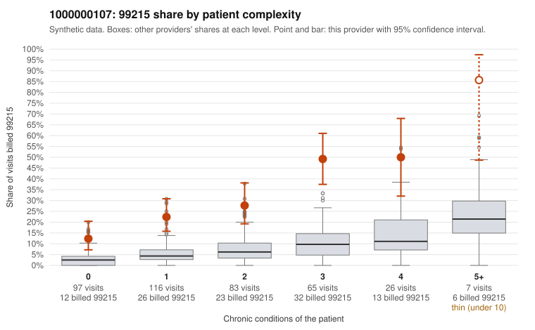

# 1000000107: 1000000107: too few returned records to judge

**Leaning (advisory):** Inconclusive

## Why

1000000107 billed 99215 on 28.4% of 394 claims against an expected 5.4% given patient complexity (risk-adjusted score 7.44; plain z-score vs peers 4.00). 34% of this provider's 99215 claims were on patients with 0 or 1 chronic conditions. Records came back for 30 claims. Of 8 documented 99215 claims, 2 (25%) were documented below the billed level, against 48% for the comparison providers. Note checks on 30 returned notes (share showing each sign): problems 30%, late 3%, unsigned 0%, data 0%. No audit trail was received. 0 of 22 notes claiming moderate-or-higher data reviewed had no lab or test line on the claim. The evidence does not support a call either way yet. Examples: C0045437: billed 99215, patient aged 61 with 0 chronic condition(s); documented MDM level moderate, 30 minutes. C0045703: billed 99215; documented MDM level moderate, 31 minutes. C0045419: billed 99215, patient aged 22 with 1 chronic condition(s) (obesity). C0045420: billed 99215, patient aged 62 with 1 chronic condition(s) (depression).

## Evidence chart

## Cited claims

`C0045437`, `C0045703`, `C0045419`, `C0045420`

## Suggested next steps

- 30 charts came back but do not settle it: request a targeted sample of 99215 charts, starting with C0045437, C0045703, C0045419.
- Re-check after the targeted charts arrive; do not call upcoding or a sicker panel on this evidence alone.

---
Citations checked: 4/4 valid. Synthetic data. The leaning is advisory; the flag comes from the statistical screen, and no clinical documentation is available beyond the sampled records-review facts shown in the packet.
