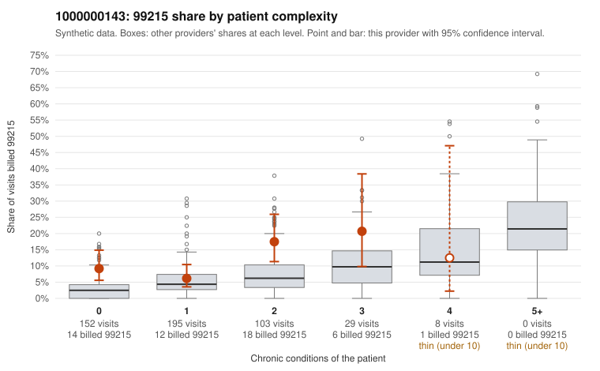

# 1000000143: 1000000143: too few returned records to judge

**Leaning (advisory):** Inconclusive

## Why

1000000143 billed 99215 on 10.5% of 487 claims against an expected 4.3% given patient complexity (risk-adjusted score 2.38; plain z-score vs peers 0.66). 51% of this provider's 99215 claims were on patients with 0 or 1 chronic conditions. Records came back for 30 claims. Of 2 documented 99215 claims, 0 (0%) were documented below the billed level, against 48% for the comparison providers. Note checks on 30 returned notes (share showing each sign): problems 27%, late 3%, unsigned 0%, data 0%. No audit trail was received. 0 of 16 notes claiming moderate-or-higher data reviewed had no lab or test line on the claim. The evidence does not support a call either way yet. Examples: C0059666: billed 99214; documented MDM level low, minutes not recorded. C0059792: billed 99214; documented MDM level low, minutes not recorded. C0059673: billed 99215, patient aged 41 with 0 chronic condition(s). C0059681: billed 99215, patient aged 65 with 0 chronic condition(s).

## Evidence chart

## Cited claims

`C0059666`, `C0059792`, `C0059673`, `C0059681`

## Suggested next steps

- 30 charts came back but do not settle it: request a targeted sample of 99215 charts, starting with C0059666, C0059792, C0059673.
- Re-check after the targeted charts arrive; do not call upcoding or a sicker panel on this evidence alone.

---
Citations checked: 4/4 valid. Synthetic data. The leaning is advisory; the flag comes from the statistical screen, and no clinical documentation is available beyond the sampled records-review facts shown in the packet.
