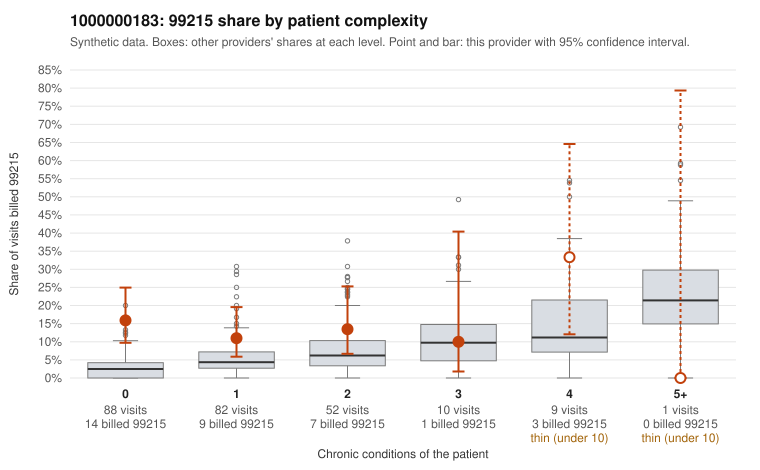

# 1000000183: 1000000183: 1 of 20 documented 99215 claims (5%) are documented below the billed level

**Leaning (advisory):** Pattern consistent with upcoding

## Why

1000000183 billed 99215 on 14.1% of 242 claims against an expected 4.4% given patient complexity (risk-adjusted score 2.61; plain z-score vs peers 1.32). 68% of this provider's 99215 claims were on patients with 0 or 1 chronic conditions. Records came back for 45 claims. Of 20 documented 99215 claims, 1 (5%) were documented below the billed level, against 48% for the comparison providers. Note checks on 45 returned notes (share showing each sign): problems 44%, late 31%, unsigned 0%, data 13%, bulk created 2%, paste heavy 2%. 9 of 34 notes claiming moderate-or-higher data reviewed had no lab or test line on the claim. This pattern is consistent with upcoding. It is a reason to review the records, not a finding. Examples: C0075707: billed 99215; documented MDM level moderate, minutes not recorded. C0075613: billed 99215, patient aged 52 with 0 chronic condition(s). C0075619: billed 99215, patient aged 35 with 0 chronic condition(s). C0075622: billed 99215, patient aged 59 with 1 chronic condition(s) (hypertension).

## Evidence chart

## Cited claims

`C0075707`, `C0075613`, `C0075619`, `C0075622`

## Suggested next steps

- Request the full charts for C0075707, C0075613, C0075619 and have a certified coder re-score each against the current E/M rules (medical decision making or total time).
- If the re-scoring confirms the pattern, review the random sample in the recovery packet's sampling plan before any overpayment estimate; do not extrapolate from a targeted sample.
- Look at the notes themselves: 44% address fewer problems than their level implies and 31% were signed late; request the audit trail for C0075707, C0075613, C0075619.

---
Citations checked: 4/4 valid. Synthetic data. The leaning is advisory; the flag comes from the statistical screen, and no clinical documentation is available beyond the sampled records-review facts shown in the packet.
