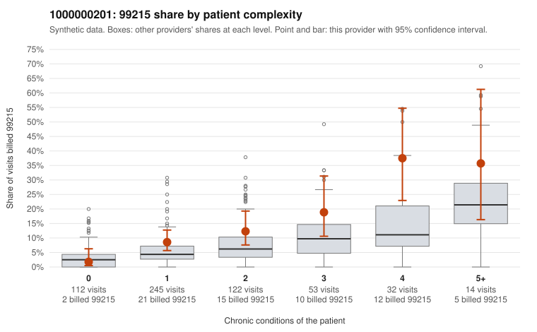

# 1000000201: 1000000201: too few returned records to judge

**Leaning (advisory):** Inconclusive

## Why

1000000201 billed 99215 on 11.2% of 578 claims against an expected 5.2% given patient complexity (risk-adjusted score 2.31; plain z-score vs peers 0.80). 35% of this provider's 99215 claims were on patients with 0 or 1 chronic conditions. Records came back for 24 claims. Of 2 documented 99215 claims, 0 (0%) were documented below the billed level, against 48% for the comparison providers. Note checks on 24 returned notes (share showing each sign): problems 21%, late 4%, unsigned 0%, data 0%. No audit trail was received. 2 of 13 notes claiming moderate-or-higher data reviewed had no lab or test line on the claim. The evidence does not support a call either way yet. Examples: C0088036: billed 99214; documented MDM level low, 26 minutes. C0087931: billed 99215, patient aged 41 with 1 chronic condition(s) (hyperlipidemia). C0087946: billed 99215, patient aged 27 with 1 chronic condition(s) (obesity).

## Evidence chart

## Cited claims

`C0088036`, `C0087931`, `C0087946`

## Suggested next steps

- 24 charts came back but do not settle it: request a targeted sample of 99215 charts, starting with C0088036, C0087931, C0087946.
- Re-check after the targeted charts arrive; do not call upcoding or a sicker panel on this evidence alone.

---
Citations checked: 3/3 valid. Synthetic data. The leaning is advisory; the flag comes from the statistical screen, and no clinical documentation is available beyond the sampled records-review facts shown in the packet.
