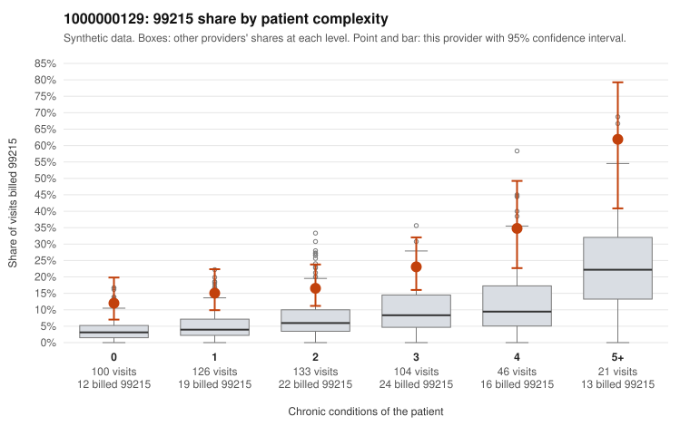

# 1000000129: 1000000129: too few returned records to judge

**Leaning (advisory):** Inconclusive

## Why

1000000129 billed 99215 on 20.0% of 530 claims against an expected 5.7% given patient complexity (risk-adjusted score 5.49; plain z-score vs peers 2.82). 29% of this provider's 99215 claims were on patients with 0 or 1 chronic conditions. Records came back for 29 claims. Of 7 documented 99215 claims, 2 (29%) were documented below the billed level, against 50% for the comparison providers. Note checks on 29 returned notes (share showing each sign): problems 24%, late 7%, unsigned 0%, data 3%. No audit trail was received. 2 of 21 notes claiming moderate-or-higher data reviewed had no lab or test line on the claim. The evidence does not support a call either way yet. Examples: C0073558: billed 99215, patient aged 52 with 1 chronic condition(s) (hypertension); documented MDM level low, minutes not recorded. C0073706: billed 99215; documented MDM level moderate, minutes not recorded. C0073328: billed 99215, patient aged 69 with 1 chronic condition(s) (depression). C0073351: billed 99215, patient aged 57 with 1 chronic condition(s) (chronic kidney disease).

## Evidence chart

## Cited claims

`C0073558`, `C0073706`, `C0073328`, `C0073351`

## Suggested next steps

- 29 charts came back but do not settle it: request a targeted sample of 99215 charts, starting with C0073558, C0073706, C0073328.
- Re-check after the targeted charts arrive; do not call upcoding or a sicker panel on this evidence alone.

---
Citations checked: 4/4 valid. Synthetic data. The leaning is advisory; the flag comes from the statistical screen, and no clinical documentation is available beyond the sampled records-review facts shown in the packet.
