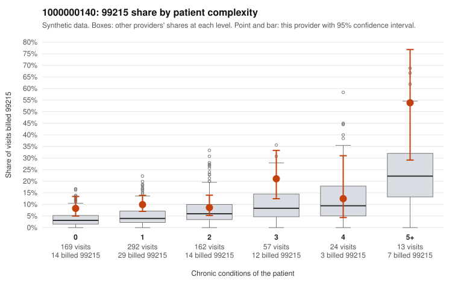

# 1000000140: 1000000140: too few returned records to judge

**Leaning (advisory):** Inconclusive

## Why

1000000140 billed 99215 on 11.0% of 717 claims against an expected 4.6% given patient complexity (risk-adjusted score 3.12; plain z-score vs peers 0.91). 54% of this provider's 99215 claims were on patients with 0 or 1 chronic conditions. Records came back for 18 claims. Of 2 documented 99215 claims, 1 (50%) were documented below the billed level, against 50% for the comparison providers. Note checks on 18 returned notes (share showing each sign): problems 6%, late 6%, unsigned 0%, data 0%. No audit trail was received. 0 of 10 notes claiming moderate-or-higher data reviewed had no lab or test line on the claim. The evidence does not support a call either way yet. Examples: C0080738: billed 99215, patient aged 45 with 1 chronic condition(s) (hyperlipidemia); documented MDM level moderate, minutes not recorded. C0080079: billed 99215, patient aged 33 with 0 chronic condition(s). C0080111: billed 99215, patient aged 56 with 1 chronic condition(s) (hyperlipidemia).

## Evidence chart

## Cited claims

`C0080738`, `C0080079`, `C0080111`

## Suggested next steps

- 18 charts came back but do not settle it: request a targeted sample of 99215 charts, starting with C0080738, C0080079, C0080111.
- Re-check after the targeted charts arrive; do not call upcoding or a sicker panel on this evidence alone.

---
Citations checked: 3/3 valid. Synthetic data. The leaning is advisory; the flag comes from the statistical screen, and no clinical documentation is available beyond the sampled records-review facts shown in the packet.
