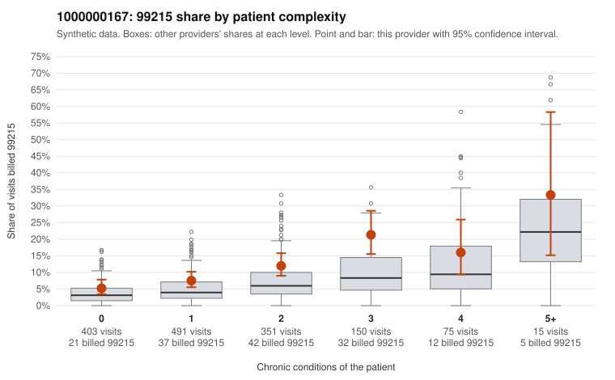

# 1000000167: 1000000167: too few returned records to judge

**Leaning (advisory):** Inconclusive

## Why

1000000167 billed 99215 on 10.0% of 1,485 claims against an expected 4.6% given patient complexity (risk-adjusted score 3.79; plain z-score vs peers 0.70). 39% of this provider's 99215 claims were on patients with 0 or 1 chronic conditions. Records came back for 30 claims. Of 3 documented 99215 claims, 0 (0%) were documented below the billed level, against 50% for the comparison providers. Note checks on 30 returned notes (share showing each sign): problems 20%, late 3%, unsigned 0%, data 3%. No audit trail was received. 2 of 15 notes claiming moderate-or-higher data reviewed had no lab or test line on the claim. The evidence does not support a call either way yet. Examples: C0095137: billed 99213; documented MDM level straightforward, minutes not recorded. C0095715: billed 99214; documented MDM level low, 25 minutes. C0094739: billed 99215, patient aged 56 with 1 chronic condition(s) (heart failure). C0094750: billed 99215, patient aged 19 with 1 chronic condition(s) (asthma).

## Evidence chart

## Cited claims

`C0095137`, `C0095715`, `C0094739`, `C0094750`

## Suggested next steps

- 30 charts came back but do not settle it: request a targeted sample of 99215 charts, starting with C0095137, C0095715, C0094739.
- Re-check after the targeted charts arrive; do not call upcoding or a sicker panel on this evidence alone.

---
Citations checked: 4/4 valid. Synthetic data. The leaning is advisory; the flag comes from the statistical screen, and no clinical documentation is available beyond the sampled records-review facts shown in the packet.
