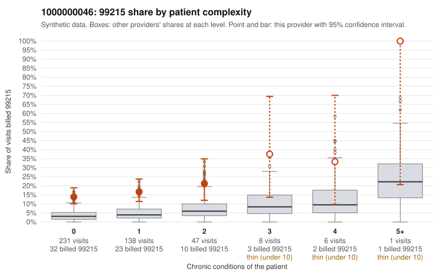

# Payment Integrity dossier: 1000000046

> Draft for human review. Statistical and records-sample evidence only; not a finding. Compliance or legal review is needed before any provider contact, notice or recoupment.

## Provider overview

| | |
|---|---|
| Specialty / state | Family Practice, GA (synthetic) |
| Claims / patients | 431 / 213 |
| Billed mix (99211 to 99215) | 5 / 9 / 148 / 198 / 71 |
| 99215 share | 16.5% |
| Expected 99215 share given patient complexity | 3.6% |
| Screen scores | z vs peers 2.07; risk-adjusted 5.58; flagged by eb_ratio_t |

## Case summary (advisory)

**Provider 1000000046's elevated 99215 billing falls mostly on patients with few or no chronic conditions, and the limited documentation returned largely fails to support the billed level, a pattern consistent with upcoding.**

Leaning: pattern consistent with upcoding. Citations checked: 6/6 valid.

1000000046 billed 99215 on 16.5% of 431 claims against an expected 3.6% given patient complexity (risk-adjusted score 5.58; plain z-score vs peers 2.07). 77% of this provider's 99215 claims were on patients with 0 or 1 chronic conditions. Records came back for 30 claims. Of 7 documented 99215 claims, 6 (86%) were documented below the billed level, against 50% for the comparison providers. Note checks on 30 returned notes (share showing each sign): problems 23%, late 0%, unsigned 0%, data 7%. No audit trail was received. 5 of 19 notes claiming moderate-or-higher data reviewed had no lab or test line on the claim. The excess 99215 share is not explained by panel acuity. Most 99215s went to patients with zero or one chronic condition, often for single symptom diagnoses such as abdominal pain or low back pain (e.g., C0029298, C0029339, C0029361). The provider's 99215 share also exceeds the all-provider rate at every complexity level, not just among sicker patients. Documentation points the same way: the unsupported rate on documented 99215s is well above peers, with moderate rather than high MDM on claims such as C0029527 and C0029503, and only C0029651 was supported. Lower-level codes also show above-peer mismatch rates. The main ambiguity is sample size: records cover only 30 claims and just 7 of them are 99215s, so the documented rate is directionally strong but statistically fragile. The note signals are also only weak evidence: some notes claim data reviewed that the claims do not show, there are repeated times and duplicates, and no audit trail was received. A reviewer should first request additional 99215 charts, prioritizing the zero-condition symptom visits, along with the EHR audit trail, to confirm whether the MDM supports high complexity and whether notes are templated or cloned. Examples: C0029503: billed 99215; documented MDM level moderate, 32 minutes. C0029527: billed 99215, patient aged 39 with 1 chronic condition(s) (asthma); documented MDM level moderate, 20 minutes. C0029546: billed 99215; documented MDM level moderate, minutes not recorded. C0029254: billed 99215, patient aged 75 with 1 chronic condition(s) (hypertension). C0029258: billed 99215, patient aged 75 with 1 chronic condition(s) (COPD). C0029295: billed 99215, patient aged 18 with 1 chronic condition(s) (obesity).

## Evidence chart

## Records-review sample so far

Documentation is on file for 30 claims (7% of this provider's claims).

| Billed | Documented | Documentation below billed level | Rate | All-provider rate |
|---|---|---|---|---|
| 99213 | 9 | 1 | 11.1% | 3.7% |
| 99214 | 14 | 3 | 21.4% | 5.9% |
| 99215 | 7 | 6 | 85.7% | 50.0% |

## Recommended next steps for Payment Integrity

1. Request records for the sampled claims in `record_request_list.csv` (35 claims across 99215).
2. Review the records against E/M documentation rules and record the supported level for each claim.
3. Run the overpayment estimator on the reviewed sample (`sampling_plan.md` explains how).
4. Notice, appeal rights, recoupment, education or corrective action, and any referral are decisions for the PI team, compliance and counsel. Nothing here drafts those.

Suggested follow-ups from the case summary:

- Request the full charts for C0029503, C0029527, C0029546 and have a certified coder re-score each against the current E/M rules (medical decision making or total time).
- If the re-scoring confirms the pattern, review the random sample in the recovery packet's sampling plan before any overpayment estimate; do not extrapolate from a targeted sample.
- Look at the notes themselves: 23% address fewer problems than their level implies and 0% were signed late; request the audit trail for C0029503, C0029527, C0029546.

## Limits

- Synthetic data; no real claims or providers.
- The leaning is advisory. The flag comes from the statistical screen; the summary explains it.
- The records-review sample is partial and was simulated for this project.
- Allowed amounts are GA Family Practice averages from a public CMS file, not this provider's actual payments.
