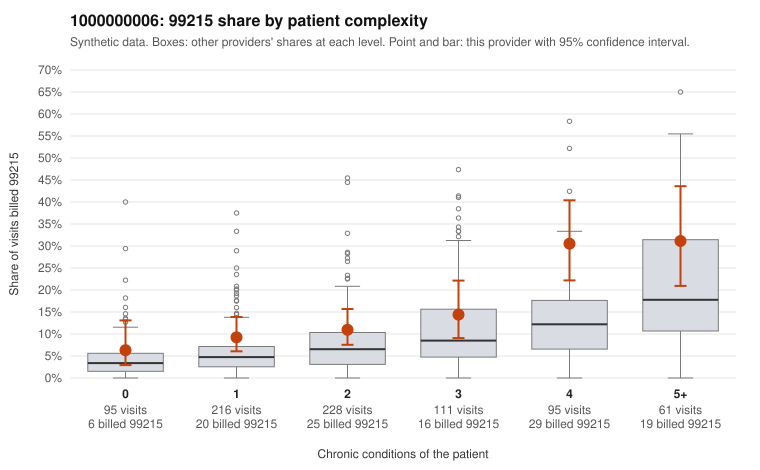

# 1000000006: 1000000006: too few returned records to judge

**Leaning (advisory):** Inconclusive

## Why

1000000006 billed 99215 on 14.3% of 806 claims against an expected 6.6% given patient complexity (risk-adjusted score 2.97; plain z-score vs peers 1.06). 23% of this provider's 99215 claims were on patients with 0 or 1 chronic conditions. Records came back for 30 claims. Of 4 documented 99215 claims, 1 (25%) were documented below the billed level, against 32% for the comparison providers. Note checks on 30 returned notes (share showing each sign): problems 17%, late 0%, unsigned 0%, data 3%. No audit trail was received. 1 of 14 notes claiming moderate-or-higher data reviewed had no lab or test line on the claim. The evidence does not support a call either way yet. Examples: C0002379: billed 99215, patient aged 27 with 1 chronic condition(s) (atrial fibrillation); documented MDM level moderate, 29 minutes. C0001644: billed 99215, patient aged 48 with 1 chronic condition(s) (obesity). C0001665: billed 99215, patient aged 41 with 0 chronic condition(s).

## Evidence chart

## Cited claims

`C0002379`, `C0001644`, `C0001665`

## Suggested next steps

- 30 charts came back but do not settle it: request a targeted sample of 99215 charts, starting with C0002379, C0001644, C0001665.
- Re-check after the targeted charts arrive; do not call upcoding or a sicker panel on this evidence alone.

---
Citations checked: 3/3 valid. Synthetic data. The leaning is advisory; the flag comes from the statistical screen, and no clinical documentation is available beyond the sampled records-review facts shown in the packet.
