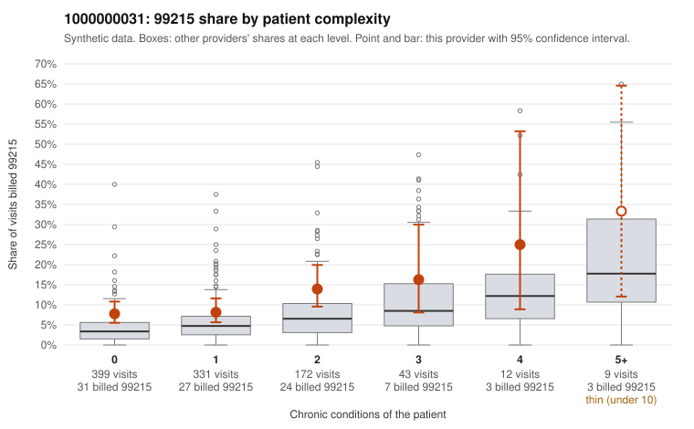

# 1000000031: 1000000031: documented 99215 claims mostly support the level billed (10% below)

**Leaning (advisory):** Pattern consistent with a high-acuity panel

## Why

1000000031 billed 99215 on 9.8% of 966 claims against an expected 4.3% given patient complexity (risk-adjusted score 2.87; plain z-score vs peers 0.35). 61% of this provider's 99215 claims were on patients with 0 or 1 chronic conditions. Records came back for 45 claims. Of 19 documented 99215 claims, 2 (10%) were documented below the billed level, against 32% for the comparison providers. Note checks on 45 returned notes (share showing each sign): problems 42%, late 9%, unsigned 0%, data 0%, bulk created 0%, paste heavy 0%. 1 of 37 notes claiming moderate-or-higher data reviewed had no lab or test line on the claim. This pattern is consistent with a high-acuity panel. The sampled documentation supports the billed level. Examples: C0020260: billed 99215; documented MDM level high, 54 minutes. C0020265: billed 99215, patient aged 30 with 0 chronic condition(s); documented MDM level high, 48 minutes. C0020413: billed 99215, patient aged 28 with 1 chronic condition(s) (depression); documented MDM level high, 44 minutes. C0019802: billed 99215, patient aged 65 with 5 chronic condition(s) (obesity;hyperlipidemia;depression;hypertension;asthma). C0019811: billed 99215, patient aged 67 with 5 chronic condition(s) (obesity;hyperlipidemia;hypertension;atrial fibrillation;asthma).

## Evidence chart

## Cited claims

`C0020260`, `C0020265`, `C0020413`, `C0019802`, `C0019811`

## Suggested next steps

- Do not pursue recovery on this evidence: 45 charts came back and they support the level billed (2 of 19 documented 99215 claims below the billed level).
- Revisit if the 99215 share keeps rising against peers or a larger sample shows unsupported claims.

---
Citations checked: 5/5 valid. Synthetic data. The leaning is advisory; the flag comes from the statistical screen, and no clinical documentation is available beyond the sampled records-review facts shown in the packet.
