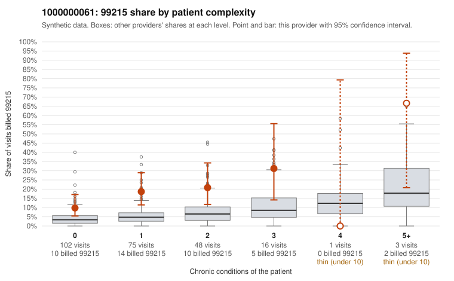

# 1000000061: 1000000061: 0 of 19 documented 99215 claims (0%) are documented below the billed level

**Leaning (advisory):** Pattern consistent with upcoding

## Why

1000000061 billed 99215 on 16.7% of 245 claims against an expected 4.4% given patient complexity (risk-adjusted score 3.22; plain z-score vs peers 1.46). 59% of this provider's 99215 claims were on patients with 0 or 1 chronic conditions. Records came back for 45 claims. Of 19 documented 99215 claims, 0 (0%) were documented below the billed level, against 32% for the comparison providers. Note checks on 45 returned notes (share showing each sign): problems 58%, late 24%, unsigned 0%, data 9%. No audit trail was received. 4 of 33 notes claiming moderate-or-higher data reviewed had no lab or test line on the claim. This pattern is consistent with upcoding. It is a reason to review the records, not a finding. Examples: C0037209: billed 99214; documented MDM level low, minutes not recorded. C0037185: billed 99215, patient aged 39 with 1 chronic condition(s) (type 2 diabetes). C0037193: billed 99215, patient aged 64 with 1 chronic condition(s) (depression). C0037230: billed 99215, patient aged 47 with 0 chronic condition(s).

## Evidence chart

## Cited claims

`C0037209`, `C0037185`, `C0037193`, `C0037230`

## Suggested next steps

- Request the full charts for C0037209, C0037185, C0037193 and have a certified coder re-score each against the current E/M rules (medical decision making or total time).
- If the re-scoring confirms the pattern, review the random sample in the recovery packet's sampling plan before any overpayment estimate; do not extrapolate from a targeted sample.
- Look at the notes themselves: 58% address fewer problems than their level implies and 24% were signed late; request the audit trail for C0037209, C0037185, C0037193.

---
Citations checked: 4/4 valid. Synthetic data. The leaning is advisory; the flag comes from the statistical screen, and no clinical documentation is available beyond the sampled records-review facts shown in the packet.
