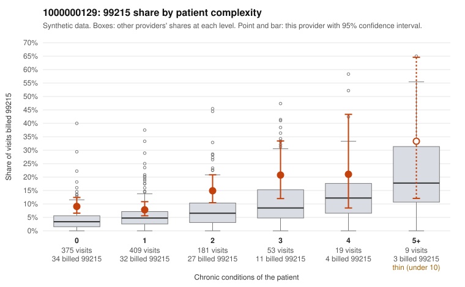

# 1000000129: 1000000129: too few returned records to judge

**Leaning (advisory):** Inconclusive

## Why

1000000129 billed 99215 on 10.6% of 1,046 claims against an expected 4.4% given patient complexity (risk-adjusted score 3.35; plain z-score vs peers 0.48). 59% of this provider's 99215 claims were on patients with 0 or 1 chronic conditions. Records came back for 45 claims. Of 17 documented 99215 claims, 7 (41%) were documented below the billed level, against 32% for the comparison providers. Note checks on 45 returned notes (share showing each sign): problems 44%, late 2%, unsigned 0%, data 11%, bulk created 0%, paste heavy 0%. 5 of 36 notes claiming moderate-or-higher data reviewed had no lab or test line on the claim. The evidence does not support a call either way yet. Examples: C0060861: billed 99215, patient aged 65 with 1 chronic condition(s) (hypothyroidism); documented MDM level moderate, minutes not recorded. C0060874: billed 99215; documented MDM level moderate, 32 minutes. C0060822: billed 99215, patient aged 34 with 1 chronic condition(s) (hypertension); documented MDM level high, minutes not recorded. C0060838: billed 99215, patient aged 27 with 0 chronic condition(s).

## Evidence chart

## Cited claims

`C0060861`, `C0060874`, `C0060822`, `C0060838`

## Suggested next steps

- 45 charts came back but do not settle it: request a targeted sample of 99215 charts, starting with C0060861, C0060874, C0060822.
- Re-check after the targeted charts arrive; do not call upcoding or a sicker panel on this evidence alone.

---
Citations checked: 4/4 valid. Synthetic data. The leaning is advisory; the flag comes from the statistical screen, and no clinical documentation is available beyond the sampled records-review facts shown in the packet.
