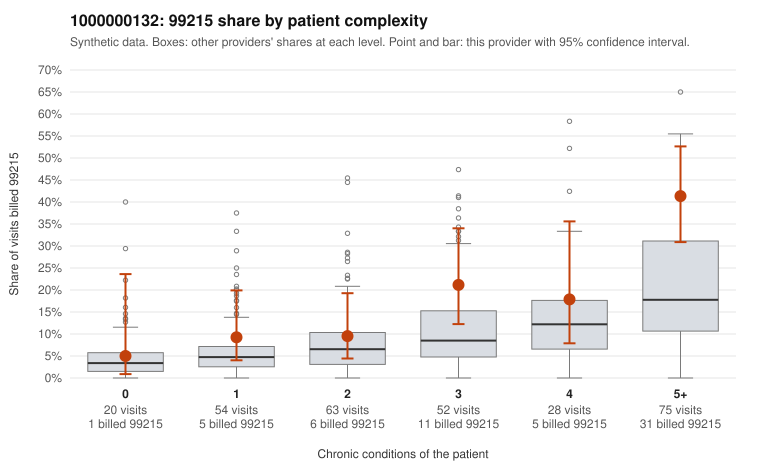

# 1000000132: 1000000132: too few returned records to judge

**Leaning (advisory):** Inconclusive

## Why

1000000132 billed 99215 on 20.2% of 292 claims against an expected 9.1% given patient complexity (risk-adjusted score 2.21; plain z-score vs peers 2.01). 10% of this provider's 99215 claims were on patients with 0 or 1 chronic conditions. Records came back for 30 claims. Of 3 documented 99215 claims, 2 (67%) were documented below the billed level, against 32% for the comparison providers. Note checks on 30 returned notes (share showing each sign): problems 7%, late 10%, unsigned 0%, data 3%. No audit trail was received. 2 of 21 notes claiming moderate-or-higher data reviewed had no lab or test line on the claim. The evidence does not support a call either way yet. Examples: C0062904: billed 99215, patient aged 72 with 0 chronic condition(s); documented MDM level moderate, 37 minutes. C0063075: billed 99215; documented MDM level moderate, 39 minutes. C0062902: billed 99215, patient aged 32 with 1 chronic condition(s) (COPD); documented MDM level high, minutes not recorded.

## Evidence chart

## Cited claims

`C0062904`, `C0063075`, `C0062902`

## Suggested next steps

- 30 charts came back but do not settle it: request a targeted sample of 99215 charts, starting with C0062904, C0063075, C0062902.
- Re-check after the targeted charts arrive; do not call upcoding or a sicker panel on this evidence alone.

---
Citations checked: 3/3 valid. Synthetic data. The leaning is advisory; the flag comes from the statistical screen, and no clinical documentation is available beyond the sampled records-review facts shown in the packet.
