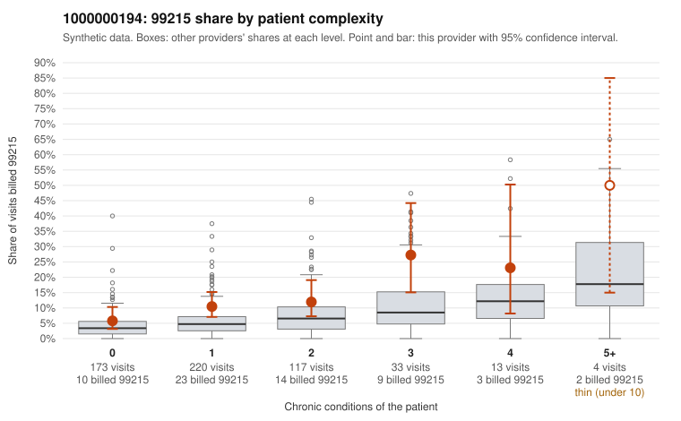

# 1000000194: 1000000194: too few returned records to judge

**Leaning (advisory):** Inconclusive

## Why

1000000194 billed 99215 on 10.9% of 560 claims against an expected 4.5% given patient complexity (risk-adjusted score 2.40; plain z-score vs peers 0.52). 54% of this provider's 99215 claims were on patients with 0 or 1 chronic conditions. Records came back for 43 claims. Of 18 documented 99215 claims, 6 (33%) were documented below the billed level, against 32% for the comparison providers. Note checks on 43 returned notes (share showing each sign): problems 35%, late 7%, unsigned 0%, data 0%. No audit trail was received. 4 of 34 notes claiming moderate-or-higher data reviewed had no lab or test line on the claim. The evidence does not support a call either way yet. Examples: C0089695: billed 99215, patient aged 59 with 1 chronic condition(s) (hypertension); documented MDM level moderate, 39 minutes. C0089791: billed 99215; documented MDM level moderate, 30 minutes. C0089659: billed 99215, patient aged 72 with 1 chronic condition(s) (depression). C0089669: billed 99215, patient aged 58 with 0 chronic condition(s).

## Evidence chart

## Cited claims

`C0089695`, `C0089791`, `C0089659`, `C0089669`

## Suggested next steps

- 43 charts came back but do not settle it: request a targeted sample of 99215 charts, starting with C0089695, C0089791, C0089659.
- Re-check after the targeted charts arrive; do not call upcoding or a sicker panel on this evidence alone.

---
Citations checked: 4/4 valid. Synthetic data. The leaning is advisory; the flag comes from the statistical screen, and no clinical documentation is available beyond the sampled records-review facts shown in the packet.
