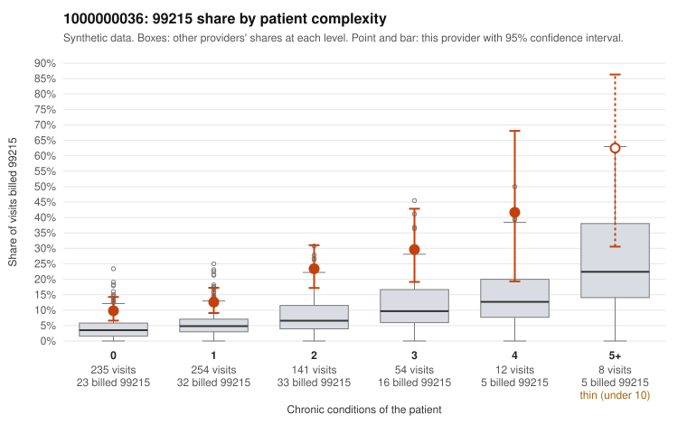

# 1000000036: 1000000036: too few returned records to judge

**Leaning (advisory):** Inconclusive

## Why

1000000036 billed 99215 on 16.2% of 704 claims against an expected 4.9% given patient complexity (risk-adjusted score 4.99; plain z-score vs peers 1.35). 48% of this provider's 99215 claims were on patients with 0 or 1 chronic conditions. Records came back for 45 claims. Of 18 documented 99215 claims, 2 (11%) were documented below the billed level, against 28% for the comparison providers. Note checks on 45 returned notes (share showing each sign): problems 33%, late 2%, unsigned 0%, data 2%. No audit trail was received. 4 of 32 notes claiming moderate-or-higher data reviewed had no lab or test line on the claim. The evidence does not support a call either way yet. Examples: C0022284: billed 99215; documented MDM level moderate, 29 minutes. C0022649: billed 99215, patient aged 58 with 1 chronic condition(s) (hypertension); documented MDM level moderate, minutes not recorded. C0021943: billed 99215, patient aged 36 with 0 chronic condition(s); documented MDM level high, 53 minutes. C0021947: billed 99215, patient aged 36 with 0 chronic condition(s).

## Evidence chart

## Cited claims

`C0022284`, `C0022649`, `C0021943`, `C0021947`

## Suggested next steps

- 45 charts came back but do not settle it: request a targeted sample of 99215 charts, starting with C0022284, C0022649, C0021943.
- Re-check after the targeted charts arrive; do not call upcoding or a sicker panel on this evidence alone.

---
Citations checked: 4/4 valid. Synthetic data. The leaning is advisory; the flag comes from the statistical screen, and no clinical documentation is available beyond the sampled records-review facts shown in the packet.
