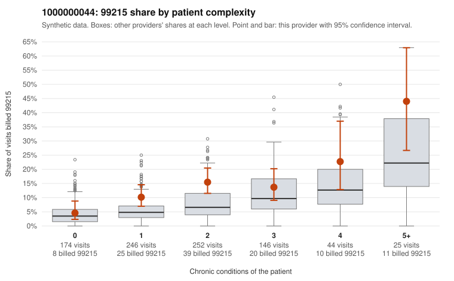

# 1000000044: 1000000044: documented 99215 claims mostly support the level billed (14% below)

**Leaning (advisory):** Pattern consistent with a high-acuity panel

## Why

1000000044 billed 99215 on 12.7% of 887 claims against an expected 6.0% given patient complexity (risk-adjusted score 2.99; plain z-score vs peers 0.78). 29% of this provider's 99215 claims were on patients with 0 or 1 chronic conditions. Records came back for 30 claims. Of 7 documented 99215 claims, 1 (14%) were documented below the billed level, against 28% for the comparison providers. Note checks on 30 returned notes (share showing each sign): problems 37%, late 7%, unsigned 0%, data 0%, bulk created 0%, paste heavy 0%. 0 of 22 notes claiming moderate-or-higher data reviewed had no lab or test line on the claim. This pattern is consistent with a high-acuity panel. The sampled documentation supports the billed level. Examples: C0024592: billed 99215; documented MDM level high, 43 minutes. C0025072: billed 99215; documented MDM level high, minutes not recorded. C0025292: billed 99215, patient aged 61 with 0 chronic condition(s); documented MDM level high, minutes not recorded. C0024637: billed 99215, patient aged 74 with 5 chronic condition(s) (type 2 diabetes;hyperlipidemia;depression;atrial fibrillation;chronic kidney disease). C0024647: billed 99215, patient aged 77 with 4 chronic condition(s) (type 2 diabetes;hyperlipidemia;hypertension;asthma).

## Evidence chart

## Cited claims

`C0024592`, `C0025072`, `C0025292`, `C0024637`, `C0024647`

## Suggested next steps

- Do not pursue recovery on this evidence: 30 charts came back and they support the level billed (1 of 7 documented 99215 claims below the billed level).
- Revisit if the 99215 share keeps rising against peers or a larger sample shows unsupported claims.

---
Citations checked: 5/5 valid. Synthetic data. The leaning is advisory; the flag comes from the statistical screen, and no clinical documentation is available beyond the sampled records-review facts shown in the packet.
