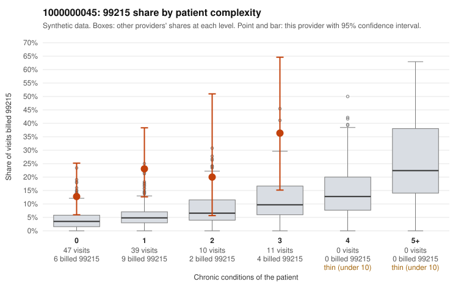

# 1000000045: 1000000045: too few returned records to judge

**Leaning (advisory):** Inconclusive

## Why

1000000045 billed 99215 on 19.6% of 107 claims against an expected 4.4% given patient complexity (risk-adjusted score 2.69; plain z-score vs peers 1.92). 71% of this provider's 99215 claims were on patients with 0 or 1 chronic conditions. Records came back for 43 claims. Of 20 documented 99215 claims, 3 (15%) were documented below the billed level, against 28% for the comparison providers. Note checks on 43 returned notes (share showing each sign): problems 42%, late 2%, unsigned 0%, data 5%, bulk created 0%, paste heavy 2%. 3 of 31 notes claiming moderate-or-higher data reviewed had no lab or test line on the claim. The evidence does not support a call either way yet. Examples: C0025498: billed 99215, patient aged 45 with 0 chronic condition(s); documented MDM level moderate, 39 minutes. C0025549: billed 99215, patient aged 65 with 1 chronic condition(s) (obesity); documented MDM level moderate, minutes not recorded. C0025444: billed 99215, patient aged 35 with 1 chronic condition(s) (hypertension). C0025459: billed 99215, patient aged 45 with 0 chronic condition(s).

## Evidence chart

## Cited claims

`C0025498`, `C0025549`, `C0025444`, `C0025459`

## Suggested next steps

- 43 charts came back but do not settle it: request a targeted sample of 99215 charts, starting with C0025498, C0025549, C0025444.
- Re-check after the targeted charts arrive; do not call upcoding or a sicker panel on this evidence alone.

---
Citations checked: 4/4 valid. Synthetic data. The leaning is advisory; the flag comes from the statistical screen, and no clinical documentation is available beyond the sampled records-review facts shown in the packet.
