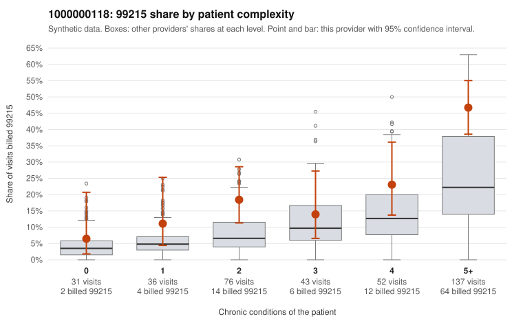

# 1000000118: 1000000118: documented 99215 claims mostly support the level billed (8% below)

**Leaning (advisory):** Pattern consistent with a high-acuity panel

## Why

1000000118 billed 99215 on 27.2% of 375 claims against an expected 11.2% given patient complexity (risk-adjusted score 3.53; plain z-score vs peers 3.17). 6% of this provider's 99215 claims were on patients with 0 or 1 chronic conditions. Records came back for 29 claims. Of 12 documented 99215 claims, 1 (8%) were documented below the billed level, against 28% for the comparison providers. Note checks on 29 returned notes (share showing each sign): problems 7%, late 3%, unsigned 0%, data 3%. No audit trail was received. 1 of 20 notes claiming moderate-or-higher data reviewed had no lab or test line on the claim. This pattern is consistent with a high-acuity panel. The sampled documentation supports the billed level. Examples: C0071103: billed 99215, patient aged 54 with 0 chronic condition(s); documented MDM level high, minutes not recorded. C0071187: billed 99215; documented MDM level high, 41 minutes. C0071340: billed 99215; documented MDM level high, 43 minutes. C0071162: billed 99215, patient aged 51 with 4 chronic condition(s) (type 2 diabetes;hyperlipidemia;hypertension;osteoarthritis). C0071233: billed 99215, patient aged 74 with 5 chronic condition(s) (type 2 diabetes;hyperlipidemia;depression;hypertension;asthma).

## Evidence chart

## Cited claims

`C0071103`, `C0071187`, `C0071340`, `C0071162`, `C0071233`

## Suggested next steps

- Do not pursue recovery on this evidence: 29 charts came back and they support the level billed (1 of 12 documented 99215 claims below the billed level).
- Revisit if the 99215 share keeps rising against peers or a larger sample shows unsupported claims.

---
Citations checked: 5/5 valid. Synthetic data. The leaning is advisory; the flag comes from the statistical screen, and no clinical documentation is available beyond the sampled records-review facts shown in the packet.
