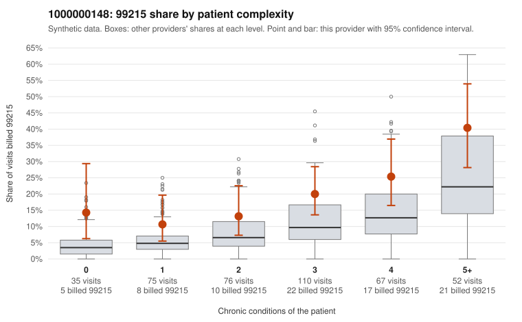

# 1000000148: 1000000148: too few returned records to judge

**Leaning (advisory):** Inconclusive

## Why

1000000148 billed 99215 on 20.0% of 415 claims against an expected 8.5% given patient complexity (risk-adjusted score 3.01; plain z-score vs peers 1.98). 16% of this provider's 99215 claims were on patients with 0 or 1 chronic conditions. Records came back for 28 claims. Of 7 documented 99215 claims, 2 (29%) were documented below the billed level, against 28% for the comparison providers. Note checks on 28 returned notes (share showing each sign): problems 18%, late 7%, unsigned 0%, data 7%. No audit trail was received. 4 of 23 notes claiming moderate-or-higher data reviewed had no lab or test line on the claim. The evidence does not support a call either way yet. Examples: C0086242: billed 99215; documented MDM level moderate, minutes not recorded. C0086596: billed 99215, patient aged 42 with 0 chronic condition(s); documented MDM level moderate, minutes not recorded. C0086268: billed 99215, patient aged 23 with 1 chronic condition(s) (COPD). C0086275: billed 99215, patient aged 79 with 1 chronic condition(s) (hyperlipidemia).

## Evidence chart

## Cited claims

`C0086242`, `C0086596`, `C0086268`, `C0086275`

## Suggested next steps

- 28 charts came back but do not settle it: request a targeted sample of 99215 charts, starting with C0086242, C0086596, C0086268.
- Re-check after the targeted charts arrive; do not call upcoding or a sicker panel on this evidence alone.

---
Citations checked: 4/4 valid. Synthetic data. The leaning is advisory; the flag comes from the statistical screen, and no clinical documentation is available beyond the sampled records-review facts shown in the packet.
