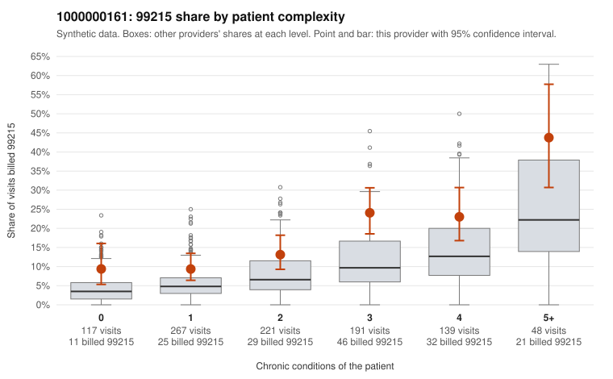

# 1000000161: 1000000161: documented 99215 claims mostly support the level billed (12% below)

**Leaning (advisory):** Pattern consistent with a high-acuity panel

## Why

1000000161 billed 99215 on 16.7% of 983 claims against an expected 7.0% given patient complexity (risk-adjusted score 4.28; plain z-score vs peers 1.43). 22% of this provider's 99215 claims were on patients with 0 or 1 chronic conditions. Records came back for 30 claims. Of 8 documented 99215 claims, 1 (12%) were documented below the billed level, against 28% for the comparison providers. Note checks on 30 returned notes (share showing each sign): problems 10%, late 0%, unsigned 0%, data 3%. No audit trail was received. 1 of 24 notes claiming moderate-or-higher data reviewed had no lab or test line on the claim. This pattern is consistent with a high-acuity panel. The sampled documentation supports the billed level. Examples: C0094759: billed 99215; documented MDM level high, 52 minutes. C0094799: billed 99215; documented MDM level high, 46 minutes. C0095144: billed 99215; documented MDM level high, 49 minutes. C0094726: billed 99215, patient aged 76 with 5 chronic condition(s) (type 2 diabetes;depression;hypertension;asthma;chronic kidney disease). C0094819: billed 99215, patient aged 70 with 5 chronic condition(s) (hypothyroidism;type 2 diabetes;obesity;depression;osteoarthritis).

## Evidence chart

## Cited claims

`C0094759`, `C0094799`, `C0095144`, `C0094726`, `C0094819`

## Suggested next steps

- Do not pursue recovery on this evidence: 30 charts came back and they support the level billed (1 of 8 documented 99215 claims below the billed level).
- Revisit if the 99215 share keeps rising against peers or a larger sample shows unsupported claims.

---
Citations checked: 5/5 valid. Synthetic data. The leaning is advisory; the flag comes from the statistical screen, and no clinical documentation is available beyond the sampled records-review facts shown in the packet.
