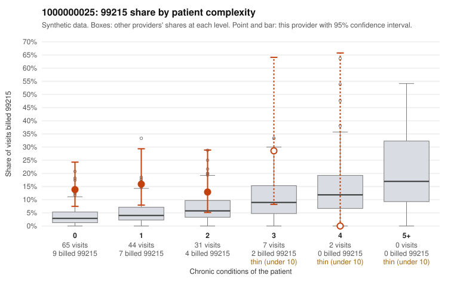

# 1000000025: 1000000025: too few returned records to judge

**Leaning (advisory):** Inconclusive

## Why

1000000025 billed 99215 on 14.8% of 149 claims against an expected 3.8% given patient complexity (risk-adjusted score 2.71; plain z-score vs peers 1.79). 73% of this provider's 99215 claims were on patients with 0 or 1 chronic conditions. Records came back for 44 claims. Of 19 documented 99215 claims, 4 (21%) were documented below the billed level, against 47% for the comparison providers. Note checks on 44 returned notes (share showing each sign): problems 55%, late 0%, unsigned 0%, data 0%, bulk created 0%, paste heavy 0%. 1 of 33 notes claiming moderate-or-higher data reviewed had no lab or test line on the claim. The evidence does not support a call either way yet. Examples: C0013259: billed 99215, patient aged 73 with 0 chronic condition(s); documented MDM level moderate, minutes not recorded. C0013261: billed 99215; documented MDM level moderate, 38 minutes. C0013188: billed 99215, patient aged 61 with 1 chronic condition(s) (hypertension); documented MDM level high, minutes not recorded. C0013208: billed 99215, patient aged 52 with 0 chronic condition(s).

## Evidence chart

## Cited claims

`C0013259`, `C0013261`, `C0013188`, `C0013208`

## Suggested next steps

- 44 charts came back but do not settle it: request a targeted sample of 99215 charts, starting with C0013259, C0013261, C0013188.
- Re-check after the targeted charts arrive; do not call upcoding or a sicker panel on this evidence alone.

---
Citations checked: 4/4 valid. Synthetic data. The leaning is advisory; the flag comes from the statistical screen, and no clinical documentation is available beyond the sampled records-review facts shown in the packet.
