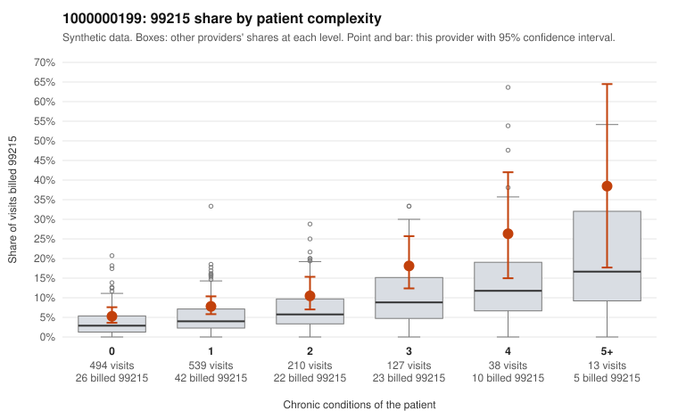

# 1000000199: 1000000199: too few returned records to judge

**Leaning (advisory):** Inconclusive

## Why

1000000199 billed 99215 on 9.0% of 1,421 claims against an expected 4.2% given patient complexity (risk-adjusted score 3.62; plain z-score vs peers 0.51). 53% of this provider's 99215 claims were on patients with 0 or 1 chronic conditions. Records came back for 45 claims. Of 16 documented 99215 claims, 4 (25%) were documented below the billed level, against 47% for the comparison providers. Note checks on 45 returned notes (share showing each sign): problems 31%, late 7%, unsigned 0%, data 7%. No audit trail was received. 6 of 33 notes claiming moderate-or-higher data reviewed had no lab or test line on the claim. The evidence does not support a call either way yet. Examples: C0099107: billed 99215; documented MDM level moderate, 39 minutes. C0099414: billed 99215; documented MDM level moderate, 31 minutes. C0098872: billed 99215, patient aged 45 with 1 chronic condition(s) (hypothyroidism). C0098971: billed 99215, patient aged 46 with 0 chronic condition(s).

## Evidence chart

## Cited claims

`C0099107`, `C0099414`, `C0098872`, `C0098971`

## Suggested next steps

- 45 charts came back but do not settle it: request a targeted sample of 99215 charts, starting with C0099107, C0099414, C0098872.
- Re-check after the targeted charts arrive; do not call upcoding or a sicker panel on this evidence alone.

---
Citations checked: 4/4 valid. Synthetic data. The leaning is advisory; the flag comes from the statistical screen, and no clinical documentation is available beyond the sampled records-review facts shown in the packet.
