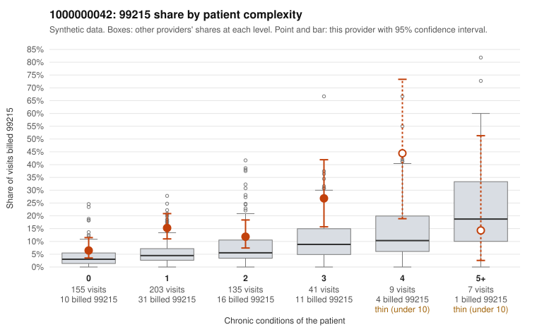

# 1000000042: 1000000042: documented 99215 claims mostly support the level billed (0% below)

**Leaning (advisory):** Pattern consistent with a high-acuity panel

## Why

1000000042 billed 99215 on 13.3% of 550 claims against an expected 4.6% given patient complexity (risk-adjusted score 3.42; plain z-score vs peers 1.00). 56% of this provider's 99215 claims were on patients with 0 or 1 chronic conditions. Records came back for 30 claims. Of 7 documented 99215 claims, 0 (0%) were documented below the billed level, against 58% for the comparison providers. Note checks on 30 returned notes (share showing each sign): problems 37%, late 3%, unsigned 0%, data 0%, bulk created 0%, paste heavy 0%. 0 of 20 notes claiming moderate-or-higher data reviewed had no lab or test line on the claim. This pattern is consistent with a high-acuity panel. The sampled documentation supports the billed level. Examples: C0017633: billed 99215; documented MDM level high, minutes not recorded. C0017714: billed 99215; documented MDM level high, minutes not recorded. C0017874: billed 99215; documented MDM level high, minutes not recorded. C0017564: billed 99215, patient aged 93 with 4 chronic condition(s) (hyperlipidemia;hypertension;COPD;osteoarthritis). C0017639: billed 99215, patient aged 73 with 4 chronic condition(s) (hyperlipidemia;hypertension;atrial fibrillation;COPD).

## Evidence chart

## Cited claims

`C0017633`, `C0017714`, `C0017874`, `C0017564`, `C0017639`

## Suggested next steps

- Do not pursue recovery on this evidence: 30 charts came back and they support the level billed (0 of 7 documented 99215 claims below the billed level).
- Revisit if the 99215 share keeps rising against peers or a larger sample shows unsupported claims.

---
Citations checked: 5/5 valid. Synthetic data. The leaning is advisory; the flag comes from the statistical screen, and no clinical documentation is available beyond the sampled records-review facts shown in the packet.
