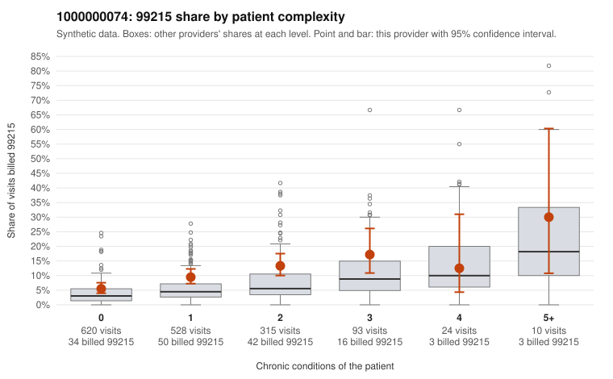

# 1000000074: 1000000074: too few returned records to judge

**Leaning (advisory):** Inconclusive

## Why

1000000074 billed 99215 on 9.3% of 1,590 claims against an expected 4.2% given patient complexity (risk-adjusted score 3.53; plain z-score vs peers 0.34). 57% of this provider's 99215 claims were on patients with 0 or 1 chronic conditions. Records came back for 30 claims. Of 3 documented 99215 claims, 2 (67%) were documented below the billed level, against 58% for the comparison providers. Note checks on 30 returned notes (share showing each sign): problems 17%, late 3%, unsigned 0%, data 0%. No audit trail was received. 2 of 13 notes claiming moderate-or-higher data reviewed had no lab or test line on the claim. The evidence does not support a call either way yet. Examples: C0031718: billed 99215, patient aged 84 with 1 chronic condition(s) (type 2 diabetes); documented MDM level moderate, minutes not recorded. C0032459: billed 99215; documented MDM level moderate, 39 minutes. C0030951: billed 99215, patient aged 45 with 1 chronic condition(s) (obesity). C0030994: billed 99215, patient aged 38 with 0 chronic condition(s).

## Evidence chart

## Cited claims

`C0031718`, `C0032459`, `C0030951`, `C0030994`

## Suggested next steps

- 30 charts came back but do not settle it: request a targeted sample of 99215 charts, starting with C0031718, C0032459, C0030951.
- Re-check after the targeted charts arrive; do not call upcoding or a sicker panel on this evidence alone.

---
Citations checked: 4/4 valid. Synthetic data. The leaning is advisory; the flag comes from the statistical screen, and no clinical documentation is available beyond the sampled records-review facts shown in the packet.
