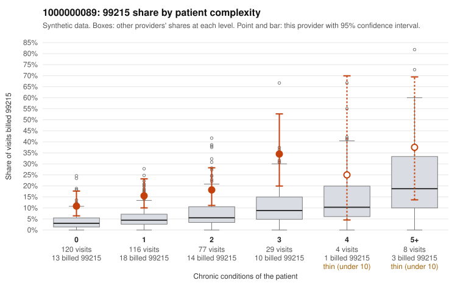

# 1000000089: 1000000089: too few returned records to judge

**Leaning (advisory):** Inconclusive

## Why

1000000089 billed 99215 on 16.7% of 354 claims against an expected 4.6% given patient complexity (risk-adjusted score 3.82; plain z-score vs peers 1.57). 53% of this provider's 99215 claims were on patients with 0 or 1 chronic conditions. Records came back for 45 claims. Of 20 documented 99215 claims, 5 (25%) were documented below the billed level, against 58% for the comparison providers. Note checks on 45 returned notes (share showing each sign): problems 47%, late 4%, unsigned 0%, data 7%, bulk created 0%, paste heavy 0%. 4 of 39 notes claiming moderate-or-higher data reviewed had no lab or test line on the claim. The evidence does not support a call either way yet. Examples: C0040386: billed 99215, patient aged 51 with 0 chronic condition(s); documented MDM level moderate, 32 minutes. C0040405: billed 99215, patient aged 52 with 0 chronic condition(s); documented MDM level moderate, 33 minutes. C0040227: billed 99215, patient aged 50 with 1 chronic condition(s) (type 2 diabetes). C0040234: billed 99215, patient aged 58 with 1 chronic condition(s) (hypertension).

## Evidence chart

## Cited claims

`C0040386`, `C0040405`, `C0040227`, `C0040234`

## Suggested next steps

- 45 charts came back but do not settle it: request a targeted sample of 99215 charts, starting with C0040386, C0040405, C0040227.
- Re-check after the targeted charts arrive; do not call upcoding or a sicker panel on this evidence alone.

---
Citations checked: 4/4 valid. Synthetic data. The leaning is advisory; the flag comes from the statistical screen, and no clinical documentation is available beyond the sampled records-review facts shown in the packet.
