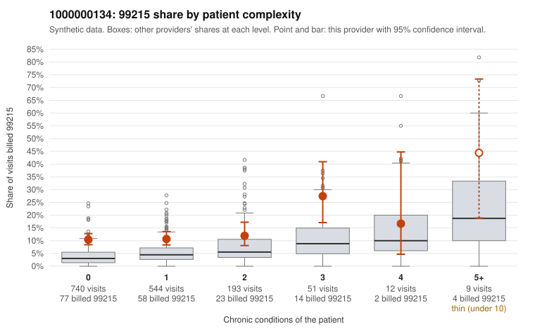

# 1000000134: 1000000134: too few returned records to judge

**Leaning (advisory):** Inconclusive

## Why

1000000134 billed 99215 on 11.5% of 1,549 claims against an expected 3.9% given patient complexity (risk-adjusted score 5.51; plain z-score vs peers 0.70). 76% of this provider's 99215 claims were on patients with 0 or 1 chronic conditions. Records came back for 45 claims. Of 19 documented 99215 claims, 13 (68%) were documented below the billed level, against 58% for the comparison providers. Note checks on 45 returned notes (share showing each sign): problems 47%, late 2%, unsigned 0%, data 4%, bulk created 0%, paste heavy 2%. 4 of 35 notes claiming moderate-or-higher data reviewed had no lab or test line on the claim. The evidence does not support a call either way yet. Examples: C0068144: billed 99215; documented MDM level moderate, 34 minutes. C0068504: billed 99215; documented MDM level moderate, 38 minutes. C0067896: billed 99215, patient aged 46 with 1 chronic condition(s) (depression). C0067905: billed 99215, patient aged 46 with 1 chronic condition(s) (osteoarthritis).

## Evidence chart

## Cited claims

`C0068144`, `C0068504`, `C0067896`, `C0067905`

## Suggested next steps

- 45 charts came back but do not settle it: request a targeted sample of 99215 charts, starting with C0068144, C0068504, C0067896.
- Re-check after the targeted charts arrive; do not call upcoding or a sicker panel on this evidence alone.

---
Citations checked: 4/4 valid. Synthetic data. The leaning is advisory; the flag comes from the statistical screen, and no clinical documentation is available beyond the sampled records-review facts shown in the packet.
