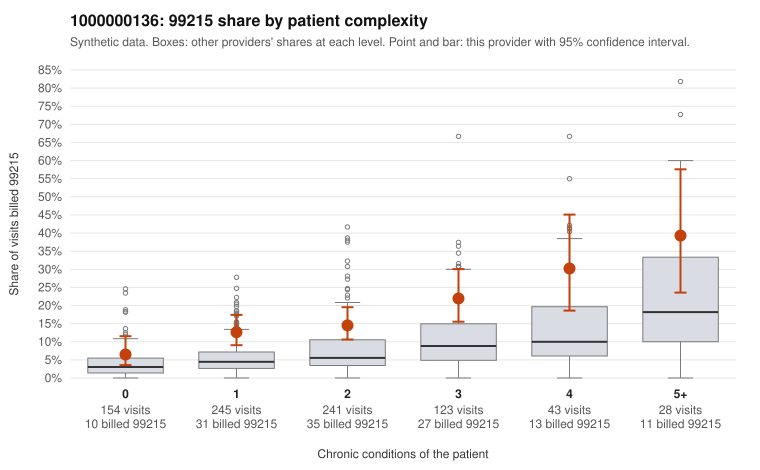

# 1000000136: Provider 1000000136 bills 99215 at roughly double the all-provider rate in every complexity band, but its few documented 99215 claims mostly support the billed level, so the evidence is mixed and the chart sample is too thin to settle it.

**Leaning (advisory):** Inconclusive

## Why

1000000136 billed 99215 on 15.2% of 834 claims against an expected 5.5% given patient complexity (risk-adjusted score 4.35; plain z-score vs peers 1.33). 32% of this provider's 99215 claims were on patients with 0 or 1 chronic conditions. Records came back for 30 claims. Of 6 documented 99215 claims, 1 (17%) were documented below the billed level, against 58% for the comparison providers. Note checks on 30 returned notes (share showing each sign): problems 20%, late 3%, unsigned 0%, data 13%. No audit trail was received. 7 of 19 notes claiming moderate-or-higher data reviewed had no lab or test line on the claim. The excess 99215 billing is not confined to complex patients: the by-complexity table shows this provider's 99215 share running about double the all-provider share even for patients with 0 or 1 conditions. That pattern is more consistent with a billing habit than with a sicker panel. The sampled low-complexity 99215s include single-condition or acute-symptom visits such as C0070172 (J06.9) and C0070201 (N39.0). Against that, 5 of the 6 documented 99215 claims supported the billed level, well below the comparison unsupported rate. However, six charts is too few to clear or confirm the provider, and one supported claim, C0070424, is a single-condition patient documented at high MDM. The data-reviewed claims made without lab or test lines on the claim are weak evidence that some notes may be templated or inflated rather than true support, and no audit trail was received to check that. A reviewer should first request more 99215 charts, prioritizing low-complexity claims like those listed, along with the EHR audit trail. They should then compare the documented MDM and data elements against what the claims actually show. Examples: C0070485: billed 99215, patient aged 65 with 0 chronic condition(s); documented MDM level moderate, minutes not recorded. C0069744: billed 99215, patient aged 75 with 1 chronic condition(s) (hyperlipidemia). C0069809: billed 99215, patient aged 35 with 1 chronic condition(s) (hypertension).

## Evidence chart

## Cited claims

`C0070485`, `C0069744`, `C0069809`

## Suggested next steps

- 30 charts came back but do not settle it: request a targeted sample of 99215 charts, starting with C0070485, C0069744, C0069809.
- Re-check after the targeted charts arrive; do not call upcoding or a sicker panel on this evidence alone.

---
Citations checked: 3/3 valid. Synthetic data. The leaning is advisory; the flag comes from the statistical screen, and no clinical documentation is available beyond the sampled records-review facts shown in the packet.
