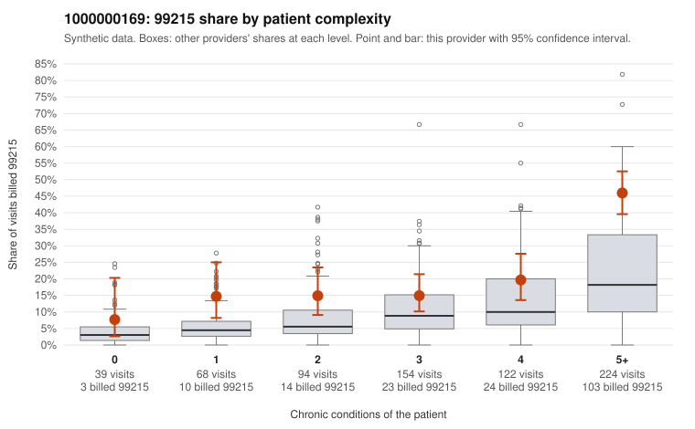

# 1000000169: 1000000169: documented 99215 claims mostly support the level billed (11% below)

**Leaning (advisory):** Pattern consistent with a high-acuity panel

## Why

1000000169 billed 99215 on 25.2% of 701 claims against an expected 10.4% given patient complexity (risk-adjusted score 4.64; plain z-score vs peers 3.02). 7% of this provider's 99215 claims were on patients with 0 or 1 chronic conditions. Records came back for 30 claims. Of 9 documented 99215 claims, 1 (11%) were documented below the billed level, against 58% for the comparison providers. Note checks on 30 returned notes (share showing each sign): problems 7%, late 3%, unsigned 0%, data 3%. No audit trail was received. 1 of 25 notes claiming moderate-or-higher data reviewed had no lab or test line on the claim. This pattern is consistent with a high-acuity panel. The sampled documentation supports the billed level. Examples: C0089008: billed 99215; documented MDM level high, 43 minutes. C0089064: billed 99215; documented MDM level high, minutes not recorded. C0089179: billed 99215; documented MDM level high, 49 minutes. C0089034: billed 99215, patient aged 74 with 4 chronic condition(s) (type 2 diabetes;obesity;hypertension;asthma). C0089350: billed 99215, patient aged 64 with 4 chronic condition(s) (obesity;hyperlipidemia;hypertension;osteoarthritis).

## Evidence chart

## Cited claims

`C0089008`, `C0089064`, `C0089179`, `C0089034`, `C0089350`

## Suggested next steps

- Do not pursue recovery on this evidence: 30 charts came back and they support the level billed (1 of 9 documented 99215 claims below the billed level).
- Revisit if the 99215 share keeps rising against peers or a larger sample shows unsupported claims.

---
Citations checked: 5/5 valid. Synthetic data. The leaning is advisory; the flag comes from the statistical screen, and no clinical documentation is available beyond the sampled records-review facts shown in the packet.
