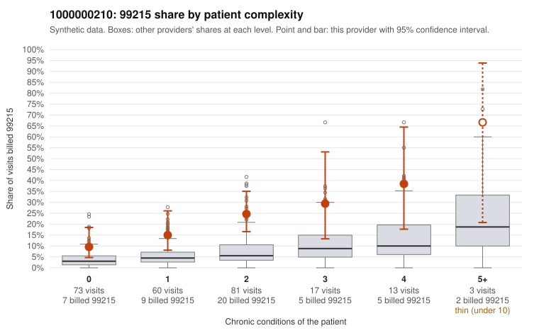

# 1000000210: 1000000210: too few returned records to judge

**Leaning (advisory):** Inconclusive

## Why

1000000210 billed 99215 on 19.4% of 247 claims against an expected 4.9% given patient complexity (risk-adjusted score 3.74; plain z-score vs peers 2.04). 33% of this provider's 99215 claims were on patients with 0 or 1 chronic conditions. Records came back for 43 claims. Of 19 documented 99215 claims, 4 (21%) were documented below the billed level, against 58% for the comparison providers. Note checks on 43 returned notes (share showing each sign): problems 19%, late 2%, unsigned 0%, data 5%. No audit trail was received. 4 of 30 notes claiming moderate-or-higher data reviewed had no lab or test line on the claim. The evidence does not support a call either way yet. Examples: C0113719: billed 99215; documented MDM level moderate, minutes not recorded. C0113760: billed 99215; documented MDM level moderate, 36 minutes. C0113743: billed 99215, patient aged 36 with 0 chronic condition(s). C0113746: billed 99215, patient aged 25 with 0 chronic condition(s).

## Evidence chart

## Cited claims

`C0113719`, `C0113760`, `C0113743`, `C0113746`

## Suggested next steps

- 43 charts came back but do not settle it: request a targeted sample of 99215 charts, starting with C0113719, C0113760, C0113743.
- Re-check after the targeted charts arrive; do not call upcoding or a sicker panel on this evidence alone.

---
Citations checked: 4/4 valid. Synthetic data. The leaning is advisory; the flag comes from the statistical screen, and no clinical documentation is available beyond the sampled records-review facts shown in the packet.
