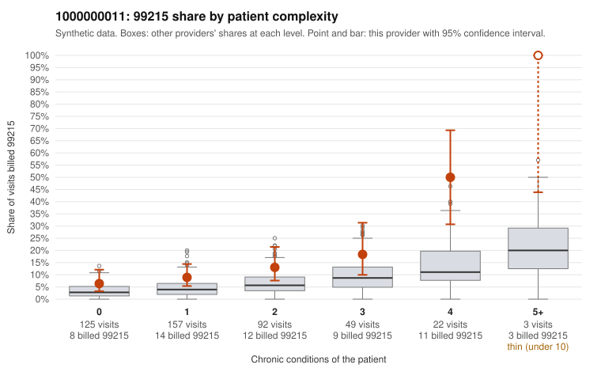

# 1000000011: 1000000011: documented 99215 claims mostly support the level billed (18% below)

**Leaning (advisory):** Pattern consistent with a high-acuity panel

## Why

1000000011 billed 99215 on 12.7% of 448 claims against an expected 4.5% given patient complexity (risk-adjusted score 3.73; plain z-score vs peers 1.35). 39% of this provider's 99215 claims were on patients with 0 or 1 chronic conditions. Records came back for 44 claims. Of 22 documented 99215 claims, 4 (18%) were documented below the billed level, against 30% for the comparison providers. Note checks on 44 returned notes (share showing each sign): problems 32%, late 2%, unsigned 0%, data 2%. No audit trail was received. 1 of 31 notes claiming moderate-or-higher data reviewed had no lab or test line on the claim. This pattern is consistent with a high-acuity panel. The sampled documentation supports the billed level. Examples: C0006510: billed 99215, patient aged 58 with 1 chronic condition(s) (hyperlipidemia); documented MDM level high, 46 minutes. C0006696: billed 99215; documented MDM level high, 43 minutes. C0006765: billed 99215, patient aged 82 with 1 chronic condition(s) (depression); documented MDM level high, 51 minutes. C0006460: billed 99215, patient aged 83 with 4 chronic condition(s) (hypothyroidism;type 2 diabetes;hyperlipidemia;osteoarthritis). C0006591: billed 99215, patient aged 91 with 5 chronic condition(s) (type 2 diabetes;obesity;atrial fibrillation;asthma;chronic kidney disease).

## Evidence chart

## Cited claims

`C0006510`, `C0006696`, `C0006765`, `C0006460`, `C0006591`

## Suggested next steps

- Do not pursue recovery on this evidence: 44 charts came back and they support the level billed (4 of 22 documented 99215 claims below the billed level).
- Revisit if the 99215 share keeps rising against peers or a larger sample shows unsupported claims.

---
Citations checked: 5/5 valid. Synthetic data. The leaning is advisory; the flag comes from the statistical screen, and no clinical documentation is available beyond the sampled records-review facts shown in the packet.
