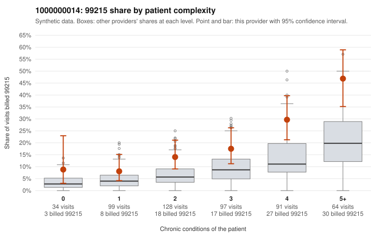

# 1000000014: 1000000014: documented 99215 claims mostly support the level billed (5% below)

**Leaning (advisory):** Pattern consistent with a high-acuity panel

## Why

1000000014 billed 99215 on 20.1% of 513 claims against an expected 7.8% given patient complexity (risk-adjusted score 4.70; plain z-score vs peers 2.93). 11% of this provider's 99215 claims were on patients with 0 or 1 chronic conditions. Records came back for 45 claims. Of 20 documented 99215 claims, 1 (5%) were documented below the billed level, against 30% for the comparison providers. Note checks on 45 returned notes (share showing each sign): problems 9%, late 4%, unsigned 0%, data 7%. No audit trail was received. 4 of 36 notes claiming moderate-or-higher data reviewed had no lab or test line on the claim. This pattern is consistent with a high-acuity panel. The sampled documentation supports the billed level. Examples: C0007176: billed 99215, patient aged 37 with 0 chronic condition(s); documented MDM level high, 48 minutes. C0007506: billed 99215; documented MDM level high, 53 minutes. C0007546: billed 99215; documented MDM level high, 40 minutes. C0007195: billed 99215, patient aged 91 with 5 chronic condition(s) (hypothyroidism;hyperlipidemia;depression;hypertension;osteoarthritis). C0007197: billed 99215, patient aged 66 with 4 chronic condition(s) (type 2 diabetes;obesity;hyperlipidemia;osteoarthritis).

## Evidence chart

## Cited claims

`C0007176`, `C0007506`, `C0007546`, `C0007195`, `C0007197`

## Suggested next steps

- Do not pursue recovery on this evidence: 45 charts came back and they support the level billed (1 of 20 documented 99215 claims below the billed level).
- Revisit if the 99215 share keeps rising against peers or a larger sample shows unsupported claims.

---
Citations checked: 5/5 valid. Synthetic data. The leaning is advisory; the flag comes from the statistical screen, and no clinical documentation is available beyond the sampled records-review facts shown in the packet.
