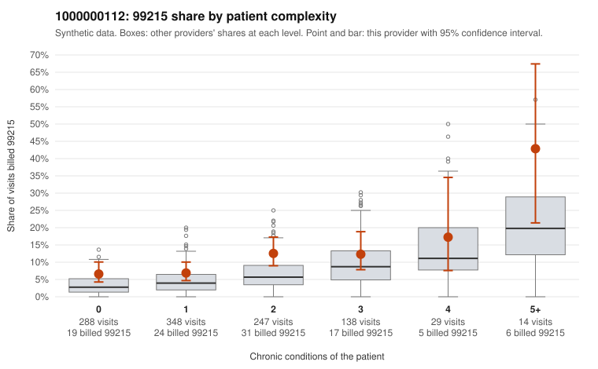

# 1000000112: 1000000112: too few returned records to judge

**Leaning (advisory):** Inconclusive

## Why

1000000112 billed 99215 on 9.6% of 1,064 claims against an expected 4.6% given patient complexity (risk-adjusted score 3.48; plain z-score vs peers 0.68). 42% of this provider's 99215 claims were on patients with 0 or 1 chronic conditions. Records came back for 30 claims. Of 2 documented 99215 claims, 0 (0%) were documented below the billed level, against 30% for the comparison providers. Note checks on 30 returned notes (share showing each sign): problems 27%, late 3%, unsigned 0%, data 3%. No audit trail was received. 2 of 18 notes claiming moderate-or-higher data reviewed had no lab or test line on the claim. The evidence does not support a call either way yet. Examples: C0061591: billed 99213; documented MDM level straightforward, minutes not recorded. C0060575: billed 99215, patient aged 46 with 1 chronic condition(s) (atrial fibrillation). C0060633: billed 99215, patient aged 43 with 1 chronic condition(s) (osteoarthritis).

## Evidence chart

## Cited claims

`C0061591`, `C0060575`, `C0060633`

## Suggested next steps

- 30 charts came back but do not settle it: request a targeted sample of 99215 charts, starting with C0061591, C0060575, C0060633.
- Re-check after the targeted charts arrive; do not call upcoding or a sicker panel on this evidence alone.

---
Citations checked: 3/3 valid. Synthetic data. The leaning is advisory; the flag comes from the statistical screen, and no clinical documentation is available beyond the sampled records-review facts shown in the packet.
