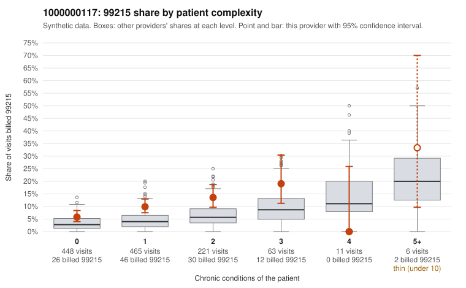

# 1000000117: 1000000117: too few returned records to judge

**Leaning (advisory):** Inconclusive

## Why

1000000117 billed 99215 on 9.6% of 1,214 claims against an expected 3.9% given patient complexity (risk-adjusted score 4.60; plain z-score vs peers 0.67). 62% of this provider's 99215 claims were on patients with 0 or 1 chronic conditions. Records came back for 6 claims. Of 1 documented 99215 claims, 1 (100%) were documented below the billed level, against 30% for the comparison providers. 1 of 3 notes claiming moderate-or-higher data reviewed had no lab or test line on the claim. The evidence does not support a call either way yet. Examples: C0066128: billed 99215; documented MDM level moderate, 31 minutes. C0065068: billed 99215, patient aged 38 with 0 chronic condition(s). C0065077: billed 99215, patient aged 27 with 1 chronic condition(s) (hypertension).

## Evidence chart

## Cited claims

`C0066128`, `C0065068`, `C0065077`

## Suggested next steps

- 6 charts came back but do not settle it: request a targeted sample of 99215 charts, starting with C0066128, C0065068, C0065077.
- Re-check after the targeted charts arrive; do not call upcoding or a sicker panel on this evidence alone.

---
Citations checked: 3/3 valid. Synthetic data. The leaning is advisory; the flag comes from the statistical screen, and no clinical documentation is available beyond the sampled records-review facts shown in the packet.
