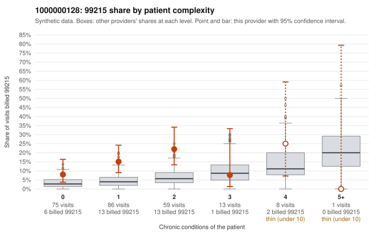

# 1000000128: 1000000128: 0 of 7 documented 99215 claims (0%) are documented below the billed level

**Leaning (advisory):** Pattern consistent with upcoding

## Why

1000000128 billed 99215 on 14.5% of 242 claims against an expected 4.2% given patient complexity (risk-adjusted score 3.54; plain z-score vs peers 1.73). 54% of this provider's 99215 claims were on patients with 0 or 1 chronic conditions. Records came back for 30 claims. Of 7 documented 99215 claims, 0 (0%) were documented below the billed level, against 30% for the comparison providers. Note checks on 30 returned notes (share showing each sign): problems 37%, late 3%, unsigned 0%, data 10%, bulk created 3%, paste heavy 10%. 4 of 20 notes claiming moderate-or-higher data reviewed had no lab or test line on the claim. This pattern is consistent with upcoding. It is a reason to review the records, not a finding. Examples: C0074430: billed 99215, patient aged 57 with 1 chronic condition(s) (hypothyroidism). C0074459: billed 99215, patient aged 47 with 1 chronic condition(s) (osteoarthritis). C0074462: billed 99215, patient aged 61 with 0 chronic condition(s).

## Evidence chart

## Cited claims

`C0074430`, `C0074459`, `C0074462`

## Suggested next steps

- Request the full charts for C0074430, C0074459, C0074462 and have a certified coder re-score each against the current E/M rules (medical decision making or total time).
- If the re-scoring confirms the pattern, review the random sample in the recovery packet's sampling plan before any overpayment estimate; do not extrapolate from a targeted sample.
- Look at the notes themselves: 37% address fewer problems than their level implies and 3% were signed late; request the audit trail for C0074430, C0074459, C0074462.

---
Citations checked: 3/3 valid. Synthetic data. The leaning is advisory; the flag comes from the statistical screen, and no clinical documentation is available beyond the sampled records-review facts shown in the packet.
