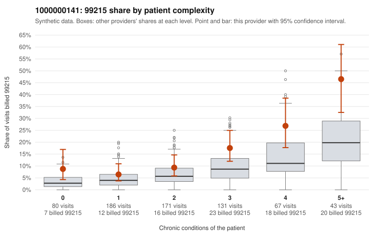

# 1000000141: 1000000141: too few returned records to judge

**Leaning (advisory):** Inconclusive

## Why

1000000141 billed 99215 on 14.2% of 678 claims against an expected 6.3% given patient complexity (risk-adjusted score 3.81; plain z-score vs peers 1.66). 20% of this provider's 99215 claims were on patients with 0 or 1 chronic conditions. Records came back for 30 claims. Of 6 documented 99215 claims, 3 (50%) were documented below the billed level, against 30% for the comparison providers. Note checks on 30 returned notes (share showing each sign): problems 17%, late 17%, unsigned 0%, data 3%, bulk created 0%, paste heavy 0%. 2 of 27 notes claiming moderate-or-higher data reviewed had no lab or test line on the claim. The evidence does not support a call either way yet. Examples: C0081308: billed 99215, patient aged 27 with 1 chronic condition(s) (type 2 diabetes); documented MDM level moderate, 23 minutes. C0081419: billed 99215; documented MDM level moderate, minutes not recorded. C0081074: billed 99215, patient aged 33 with 0 chronic condition(s). C0081077: billed 99215, patient aged 80 with 1 chronic condition(s) (hypertension).

## Evidence chart

## Cited claims

`C0081308`, `C0081419`, `C0081074`, `C0081077`

## Suggested next steps

- 30 charts came back but do not settle it: request a targeted sample of 99215 charts, starting with C0081308, C0081419, C0081074.
- Re-check after the targeted charts arrive; do not call upcoding or a sicker panel on this evidence alone.

---
Citations checked: 4/4 valid. Synthetic data. The leaning is advisory; the flag comes from the statistical screen, and no clinical documentation is available beyond the sampled records-review facts shown in the packet.
