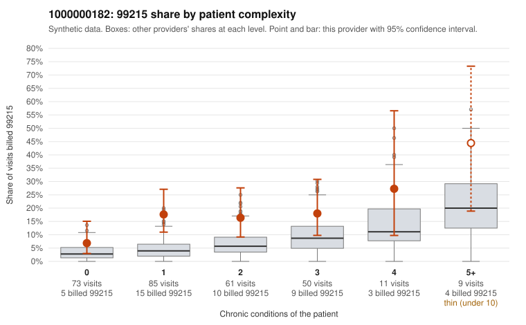

# 1000000182: 1000000182: 0 of 19 documented 99215 claims (0%) are documented below the billed level

**Leaning (advisory):** Pattern consistent with upcoding

## Why

1000000182 billed 99215 on 15.9% of 289 claims against an expected 5.1% given patient complexity (risk-adjusted score 3.77; plain z-score vs peers 2.04). 43% of this provider's 99215 claims were on patients with 0 or 1 chronic conditions. Records came back for 45 claims. Of 19 documented 99215 claims, 0 (0%) were documented below the billed level, against 30% for the comparison providers. Note checks on 45 returned notes (share showing each sign): problems 31%, late 27%, unsigned 0%, data 13%, bulk created 4%, paste heavy 7%. 6 of 23 notes claiming moderate-or-higher data reviewed had no lab or test line on the claim. This pattern is consistent with upcoding. It is a reason to review the records, not a finding. Examples: C0104380: billed 99213; documented MDM level straightforward, minutes not recorded. C0104090: billed 99215, patient aged 55 with 1 chronic condition(s) (osteoarthritis); documented MDM level high, minutes not recorded. C0104103: billed 99215, patient aged 30 with 0 chronic condition(s). C0104111: billed 99215, patient aged 27 with 1 chronic condition(s) (hypertension).

## Evidence chart

## Cited claims

`C0104380`, `C0104090`, `C0104103`, `C0104111`

## Suggested next steps

- Request the full charts for C0104380, C0104090, C0104103 and have a certified coder re-score each against the current E/M rules (medical decision making or total time).
- If the re-scoring confirms the pattern, review the random sample in the recovery packet's sampling plan before any overpayment estimate; do not extrapolate from a targeted sample.
- Look at the notes themselves: 31% address fewer problems than their level implies and 27% were signed late; request the audit trail for C0104380, C0104090, C0104103.

---
Citations checked: 4/4 valid. Synthetic data. The leaning is advisory; the flag comes from the statistical screen, and no clinical documentation is available beyond the sampled records-review facts shown in the packet.
