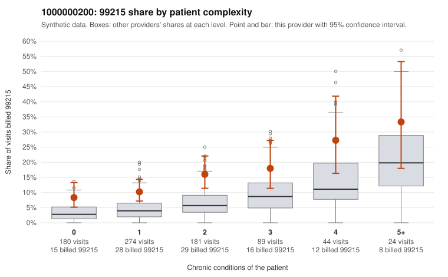

# 1000000200: Provider 1000000200 bills 99215 well above expectation in every complexity band, including many low-complexity visits, but its sampled 99215 notes fully support the billed level while showing signs of templated or inflated documentation.

**Leaning (advisory):** Inconclusive

## Why

1000000200 billed 99215 on 13.6% of 792 claims against an expected 5.0% given patient complexity (risk-adjusted score 5.01; plain z-score vs peers 1.55). 40% of this provider's 99215 claims were on patients with 0 or 1 chronic conditions. Records came back for 45 claims. Of 17 documented 99215 claims, 0 (0%) were documented below the billed level, against 30% for the comparison providers. Note checks on 45 returned notes (share showing each sign): problems 29%, late 20%, unsigned 0%, data 18%. No audit trail was received. 9 of 31 notes claiming moderate-or-higher data reviewed had no lab or test line on the claim. The billing pattern points toward upcoding: the 99215 share runs above the all-provider rate in every complexity band, and the sampled low-complexity 99215 claims include routine-looking visits, such as C0117131 (upper respiratory infection, no chronic conditions) and C0117217 (follow-up code only). The records review points the other way, since none of the 17 documented 99215 claims fell below the billed level, against roughly 30% for comparison providers, and examples such as C0117175 and C0117493 document high MDM. That clean result is the main ambiguity, because it rests on records for only about 6% of claims and the notes carry warning signs: about a third flagged as duplicates, problem and late-entry flags, and 9 notes claiming moderate-or-higher data review with no lab or test line on the claim, which is weak evidence that documentation may be cloned or inflated to match the billed code. A reviewer should first pull full charts for the low-complexity 99215 claims and compare the duplicate-flagged notes side by side for copied text, then request the EHR audit trail, which was not received, to see how and when these notes were created. Examples: C0116883: billed 99212; documented MDM level minimal, minutes not recorded. C0116862: billed 99215, patient aged 79 with 1 chronic condition(s) (obesity). C0116889: billed 99215, patient aged 60 with 0 chronic condition(s).

## Evidence chart

## Cited claims

`C0116883`, `C0116862`, `C0116889`

## Suggested next steps

- 45 charts came back but do not settle it: request a targeted sample of 99215 charts, starting with C0116883, C0116862, C0116889.
- Re-check after the targeted charts arrive; do not call upcoding or a sicker panel on this evidence alone.

---
Citations checked: 3/3 valid. Synthetic data. The leaning is advisory; the flag comes from the statistical screen, and no clinical documentation is available beyond the sampled records-review facts shown in the packet.
