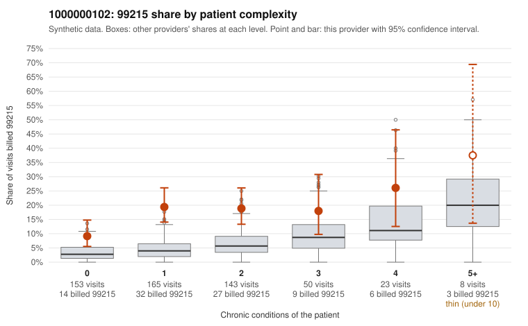

# Payment Integrity dossier: 1000000102

> Draft for human review. Statistical and records-sample evidence only; not a finding. Compliance or legal review is needed before any provider contact, notice or recoupment.

## Provider overview

| | |
|---|---|
| Specialty / state | Family Practice, GA (synthetic) |
| Claims / patients | 542 / 267 |
| Billed mix (99211 to 99215) | 5 / 15 / 178 / 253 / 91 |
| 99215 share | 16.8% |
| Expected 99215 share given patient complexity | 4.6% |
| Screen scores | z vs peers 2.23; risk-adjusted 6.08; flagged by eb_ratio_t |

## Case summary (advisory)

**1000000102: 12 of 17 documented 99215 claims (71%) are documented below the billed level**

Leaning: pattern consistent with upcoding. Citations checked: 6/6 valid.

1000000102 billed 99215 on 16.8% of 542 claims against an expected 4.6% given patient complexity (risk-adjusted score 6.08; plain z-score vs peers 2.23). 51% of this provider's 99215 claims were on patients with 0 or 1 chronic conditions. Records came back for 45 claims. Of 17 documented 99215 claims, 12 (71%) were documented below the billed level, against 30% for the comparison providers. Note checks on 45 returned notes (share showing each sign): problems 27%, late 2%, unsigned 0%, data 9%. No audit trail was received. 6 of 28 notes claiming moderate-or-higher data reviewed had no lab or test line on the claim. This pattern is consistent with upcoding. It is a reason to review the records, not a finding. Examples: C0056644: billed 99215, patient aged 41 with 0 chronic condition(s); documented MDM level moderate, minutes not recorded. C0056810: billed 99215; documented MDM level moderate, 39 minutes. C0056927: billed 99215; documented MDM level moderate, 37 minutes. C0056529: billed 99215, patient aged 27 with 0 chronic condition(s). C0056530: billed 99215, patient aged 29 with 1 chronic condition(s) (chronic kidney disease). C0056559: billed 99215, patient aged 59 with 0 chronic condition(s).

## Evidence chart

## Records-review sample so far

Documentation is on file for 45 claims (8% of this provider's claims).

| Billed | Documented | Documentation below billed level | Rate | All-provider rate |
|---|---|---|---|---|
| 99213 | 11 | 1 | 9.1% | 4.7% |
| 99214 | 15 | 4 | 26.7% | 4.4% |
| 99215 | 17 | 12 | 70.6% | 30.4% |

## Recommended next steps for Payment Integrity

1. Request records for the sampled claims in `record_request_list.csv` (40 claims across 99215).
2. Review the records against E/M documentation rules and record the supported level for each claim.
3. Run the overpayment estimator on the reviewed sample (`sampling_plan.md` explains how).
4. Notice, appeal rights, recoupment, education or corrective action, and any referral are decisions for the PI team, compliance and counsel. Nothing here drafts those.

Suggested follow-ups from the case summary:

- Request the full charts for C0056644, C0056810, C0056927 and have a certified coder re-score each against the current E/M rules (medical decision making or total time).
- If the re-scoring confirms the pattern, review the random sample in the recovery packet's sampling plan before any overpayment estimate; do not extrapolate from a targeted sample.
- Look at the notes themselves: 27% address fewer problems than their level implies and 2% were signed late; request the audit trail for C0056644, C0056810, C0056927.

## Limits

- Synthetic data; no real claims or providers.
- The leaning is advisory. The flag comes from the statistical screen; the summary explains it.
- The records-review sample is partial and was simulated for this project.
- Allowed amounts are GA Family Practice averages from a public CMS file, not this provider's actual payments.
