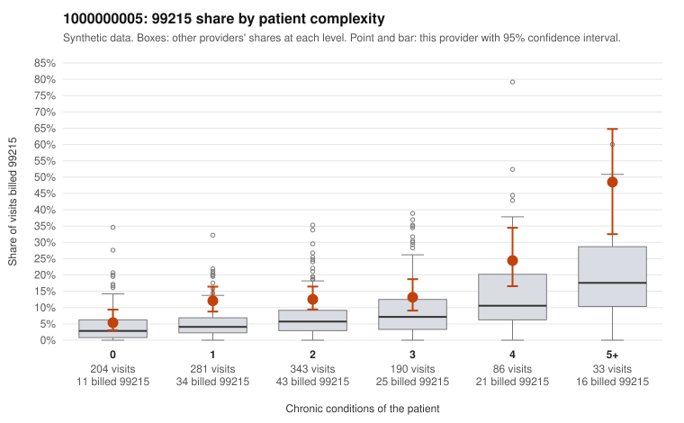

# 1000000005: 1000000005: too few returned records to judge

**Leaning (advisory):** Inconclusive

## Why

1000000005 billed 99215 on 13.2% of 1,137 claims against an expected 5.6% given patient complexity (risk-adjusted score 4.18; plain z-score vs peers 1.27). 30% of this provider's 99215 claims were on patients with 0 or 1 chronic conditions. Records came back for 30 claims. Of 4 documented 99215 claims, 0 (0%) were documented below the billed level, against 24% for the comparison providers. Note checks on 30 returned notes (share showing each sign): problems 23%, late 0%, unsigned 0%, data 10%. No audit trail was received. 5 of 26 notes claiming moderate-or-higher data reviewed had no lab or test line on the claim. The evidence does not support a call either way yet. Examples: C0002032: billed 99214; documented MDM level low, 29 minutes. C0002494: billed 99214; documented MDM level low, 26 minutes. C0002035: billed 99215, patient aged 55 with 0 chronic condition(s). C0002124: billed 99215, patient aged 70 with 1 chronic condition(s) (type 2 diabetes).

## Evidence chart

## Cited claims

`C0002032`, `C0002494`, `C0002035`, `C0002124`

## Suggested next steps

- 30 charts came back but do not settle it: request a targeted sample of 99215 charts, starting with C0002032, C0002494, C0002035.
- Re-check after the targeted charts arrive; do not call upcoding or a sicker panel on this evidence alone.

---
Citations checked: 4/4 valid. Synthetic data. The leaning is advisory; the flag comes from the statistical screen, and no clinical documentation is available beyond the sampled records-review facts shown in the packet.
