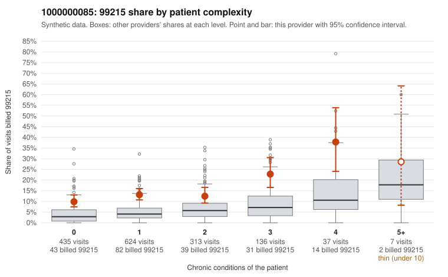

# 1000000085: 1000000085: too few returned records to judge

**Leaning (advisory):** Inconclusive

## Why

1000000085 billed 99215 on 13.6% of 1,552 claims against an expected 4.3% given patient complexity (risk-adjusted score 6.70; plain z-score vs peers 1.35). 59% of this provider's 99215 claims were on patients with 0 or 1 chronic conditions. Records came back for 30 claims. Of 7 documented 99215 claims, 0 (0%) were documented below the billed level, against 24% for the comparison providers. Note checks on 30 returned notes (share showing each sign): problems 37%, late 7%, unsigned 0%, data 3%, bulk created 0%, paste heavy 3%. 3 of 21 notes claiming moderate-or-higher data reviewed had no lab or test line on the claim. The evidence does not support a call either way yet. Examples: C0041058: billed 99214; documented MDM level low, minutes not recorded. C0041785: billed 99214; documented MDM level low, minutes not recorded. C0040292: billed 99215, patient aged 39 with 0 chronic condition(s). C0040436: billed 99215, patient aged 18 with 0 chronic condition(s).

## Evidence chart

## Cited claims

`C0041058`, `C0041785`, `C0040292`, `C0040436`

## Suggested next steps

- 30 charts came back but do not settle it: request a targeted sample of 99215 charts, starting with C0041058, C0041785, C0040292.
- Re-check after the targeted charts arrive; do not call upcoding or a sicker panel on this evidence alone.

---
Citations checked: 4/4 valid. Synthetic data. The leaning is advisory; the flag comes from the statistical screen, and no clinical documentation is available beyond the sampled records-review facts shown in the packet.
