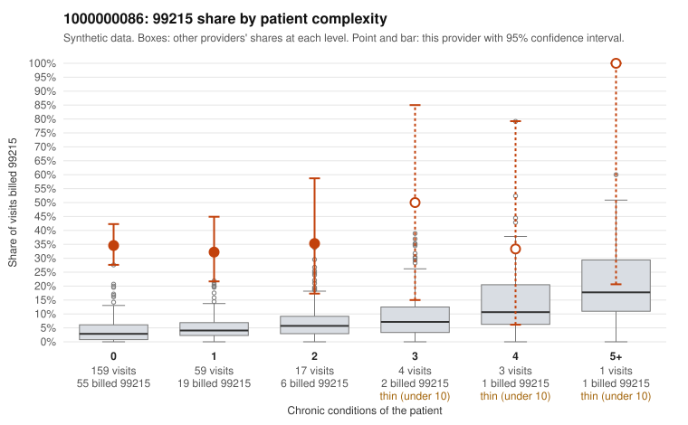

# 1000000086: 1000000086: 7 of 11 documented 99215 claims (64%) are documented below the billed level

**Leaning (advisory):** Pattern consistent with upcoding

## Why

1000000086 billed 99215 on 34.6% of 243 claims against an expected 3.5% given patient complexity (risk-adjusted score 10.00; plain z-score vs peers 5.45). 88% of this provider's 99215 claims were on patients with 0 or 1 chronic conditions. Records came back for 30 claims. Of 11 documented 99215 claims, 7 (64%) were documented below the billed level, against 24% for the comparison providers. Note checks on 30 returned notes (share showing each sign): problems 53%, late 0%, unsigned 0%, data 3%, bulk created 0%, paste heavy 0%. 1 of 25 notes claiming moderate-or-higher data reviewed had no lab or test line on the claim. This pattern is consistent with upcoding. It is a reason to review the records, not a finding. Examples: C0041949: billed 99215; documented MDM level moderate, minutes not recorded. C0041969: billed 99215, patient aged 51 with 1 chronic condition(s) (chronic kidney disease); documented MDM level moderate, 33 minutes. C0041992: billed 99215; documented MDM level moderate, 33 minutes. C0041937: billed 99215, patient aged 55 with 0 chronic condition(s). C0041943: billed 99215, patient aged 78 with 1 chronic condition(s) (hyperlipidemia). C0041964: billed 99215, patient aged 35 with 0 chronic condition(s).

## Evidence chart

## Cited claims

`C0041949`, `C0041969`, `C0041992`, `C0041937`, `C0041943`, `C0041964`

## Suggested next steps

- Request the full charts for C0041949, C0041969, C0041992 and have a certified coder re-score each against the current E/M rules (medical decision making or total time).
- If the re-scoring confirms the pattern, review the random sample in the recovery packet's sampling plan before any overpayment estimate; do not extrapolate from a targeted sample.
- Look at the notes themselves: 53% address fewer problems than their level implies and 0% were signed late; request the audit trail for C0041949, C0041969, C0041992.

---
Citations checked: 6/6 valid. Synthetic data. The leaning is advisory; the flag comes from the statistical screen, and no clinical documentation is available beyond the sampled records-review facts shown in the packet.
