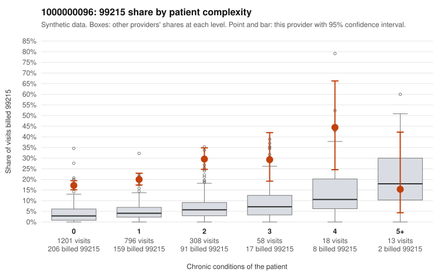

# 1000000096: 1000000096: 4 of 6 documented 99215 claims (67%) are documented below the billed level

**Leaning (advisory):** Pattern consistent with upcoding

## Why

1000000096 billed 99215 on 20.2% of 2,394 claims against an expected 3.7% given patient complexity (risk-adjusted score 16.14; plain z-score vs peers 2.64). 76% of this provider's 99215 claims were on patients with 0 or 1 chronic conditions. Records came back for 30 claims. Of 6 documented 99215 claims, 4 (67%) were documented below the billed level, against 24% for the comparison providers. Note checks on 30 returned notes (share showing each sign): problems 20%, late 7%, unsigned 0%, data 3%. No audit trail was received. 2 of 18 notes claiming moderate-or-higher data reviewed had no lab or test line on the claim. This pattern is consistent with upcoding. It is a reason to review the records, not a finding. Examples: C0047357: billed 99215; documented MDM level moderate, 37 minutes. C0047445: billed 99215; documented MDM level moderate, minutes not recorded. C0047863: billed 99215; documented MDM level moderate, 27 minutes. C0045629: billed 99215, patient aged 36 with 0 chronic condition(s). C0045631: billed 99215, patient aged 76 with 0 chronic condition(s). C0045769: billed 99215, patient aged 18 with 1 chronic condition(s) (hyperlipidemia).

## Evidence chart

## Cited claims

`C0047357`, `C0047445`, `C0047863`, `C0045629`, `C0045631`, `C0045769`

## Suggested next steps

- Request the full charts for C0047357, C0047445, C0047863 and have a certified coder re-score each against the current E/M rules (medical decision making or total time).
- If the re-scoring confirms the pattern, review the random sample in the recovery packet's sampling plan before any overpayment estimate; do not extrapolate from a targeted sample.
- Look at the notes themselves: 20% address fewer problems than their level implies and 7% were signed late; request the audit trail for C0047357, C0047445, C0047863.

---
Citations checked: 6/6 valid. Synthetic data. The leaning is advisory; the flag comes from the statistical screen, and no clinical documentation is available beyond the sampled records-review facts shown in the packet.
