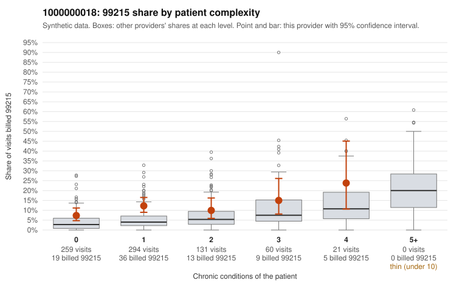

# 1000000018: 1000000018: 9 of 16 documented 99215 claims (56%) are documented below the billed level

**Leaning (advisory):** Pattern consistent with upcoding

## Why

1000000018 billed 99215 on 10.7% of 765 claims against an expected 4.1% given patient complexity (risk-adjusted score 3.72; plain z-score vs peers 0.50). 67% of this provider's 99215 claims were on patients with 0 or 1 chronic conditions. Records came back for 45 claims. Of 16 documented 99215 claims, 9 (56%) were documented below the billed level, against 29% for the comparison providers. Note checks on 45 returned notes (share showing each sign): problems 42%, late 2%, unsigned 0%, data 4%, bulk created 0%, paste heavy 0%. 2 of 30 notes claiming moderate-or-higher data reviewed had no lab or test line on the claim. This pattern is consistent with upcoding. It is a reason to review the records, not a finding. Examples: C0007644: billed 99215; documented MDM level moderate, minutes not recorded. C0007686: billed 99215, patient aged 58 with 1 chronic condition(s) (heart failure); documented MDM level moderate, minutes not recorded. C0007887: billed 99215; documented MDM level low, minutes not recorded. C0007523: billed 99215, patient aged 53 with 1 chronic condition(s) (hypothyroidism). C0007602: billed 99215, patient aged 71 with 0 chronic condition(s). C0007668: billed 99215, patient aged 18 with 0 chronic condition(s).

## Evidence chart

## Cited claims

`C0007644`, `C0007686`, `C0007887`, `C0007523`, `C0007602`, `C0007668`

## Suggested next steps

- Request the full charts for C0007644, C0007686, C0007887 and have a certified coder re-score each against the current E/M rules (medical decision making or total time).
- If the re-scoring confirms the pattern, review the random sample in the recovery packet's sampling plan before any overpayment estimate; do not extrapolate from a targeted sample.
- Look at the notes themselves: 42% address fewer problems than their level implies and 2% were signed late; request the audit trail for C0007644, C0007686, C0007887.

---
Citations checked: 6/6 valid. Synthetic data. The leaning is advisory; the flag comes from the statistical screen, and no clinical documentation is available beyond the sampled records-review facts shown in the packet.
